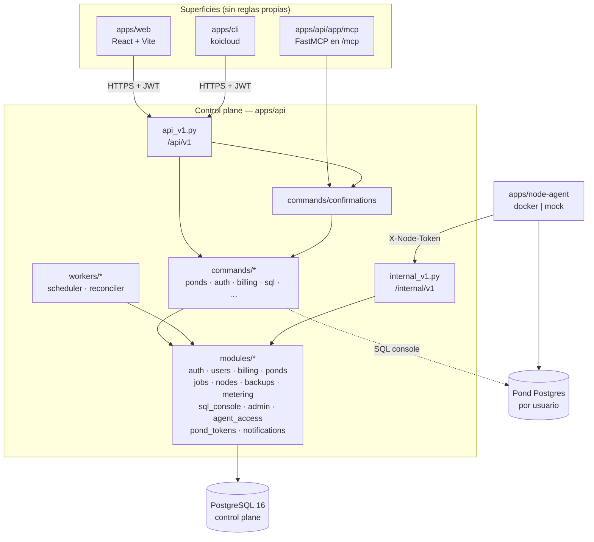

# KoiCloud — Arquitectura (resumen para agentes y entrega)

**Proyecto:** KoiCloud · DBaaS académico (PostgreSQL en Docker)  
**Curso:** Ingeniería de Software I · Universidad Rafael Landívar · 2026  
**Equipo:** Hugo Escobar · Jason Gutiérrez · Jousé Menendez · Diego Joachin

Este documento resume **cómo se comporta el sistema hoy**, derivado del código en `apps/` y del pack sellado en `docs/architecture/`. Para contratos HTTP, tablas y diagramas detallados, usa ese pack; este archivo es la puerta de entrada.

> **Mantenimiento:** cualquier PR que cambie comportamiento observable (flujos, estados, superficies, límites de confianza) debe actualizar este archivo en el mismo PR.

---

## Comportamiento en una página

1. **Un solo cerebro.** Web, CLI y MCP no implementan reglas de negocio. Llaman a `/api/v1/*` (o al montaje MCP); la API delega en `app/commands/*`, que orquesta módulos en `app/modules/*` y persiste en PostgreSQL.
2. **Control plane vs data plane.** La API nunca ejecuta `docker` directamente. Escribe estado deseado, encola jobs (`FOR UPDATE SKIP LOCKED` en la misma base) y el **node-agent** (`apps/node-agent`) materializa ponds con `docker_driver` o `mock_driver`.
3. **Estado en PostgreSQL.** Usuarios, ponds, jobs, facturación simulada, confirmaciones pendientes, acceso de agente y auditoría mínima viven en la base interna. Sin estado significativo en memoria entre requests.
4. **Superficies.** La Web usa JWT en header y el refresh en la cookie httpOnly `koi_refresh`. Al recargar, el arranque llama `POST /auth/refresh` antes de pintar el shell; si el refresh falla, la sesión queda cerrada. Cerrar sesión borra el token en memoria y vuelve al login aunque `POST /auth/logout` falle. La cookie lleva `Secure` cuando la petición es HTTPS o el entorno es producción, y el cierre repite esos atributos. CLI y MCP usan JWT; las mutaciones remotas pasan por **`propose → confirmation_token → confirm`** (409 con `summary` en español, token de 5 minutos).
5. **Consola SQL.** Conexión efímera al puerto público del pond del usuario (`asyncpg`), read-only por defecto; SQL write exige confirmación en CLI/MCP. `GET /ponds/{id}/schema` y el tool MCP `list_tables(pond_id)` leen el catálogo por esa misma conexión (sin historial SQL): tablas schema-qualified de schemas de usuario, columnas y estimación de filas; el pond debe estar `running` o responde `409 pond_busy`. El path de ejecución es el mismo para Web y MCP (`commands.sql.run_sql`); la conexión usa el rol no-superuser `koi_console` (#198), también para leer el catálogo. En la Web, el detalle del pond muestra esa lectura en la sección **Tablas** solo al pulsar **Recargar** (sin polling ni vista en vivo).
6. **Acceso temporal a un pond (S2 demo).** Además del gate de cuenta (`agent_access`), un dueño puede emitir `pond_tokens` (link + password, vence y se revoca). MCP autentica ese slug, fija `AuthContext.pond_id` y limita tools a `whoami` / `get_pond` / `run_sql` (sin `list_tables`). La allowlist se aplica en JSON-RPC y en Streamable HTTP vía `_actor_for_tool` en cada tool. `list_for_user` también filtra por `pond_id` cuando el actor está fijado. El Basic temporal no es un JWT: `/api/v1` lo rechaza. En `POST /api/v1/ponds/{pond_id}/temp-access`, `scopes` omitido, `null` o `[]` usa ese conjunto por defecto (201). Cualquier valor desconocido, vacío, con distinto casing o fuera de esa lista rechaza toda la petición con el 422 estándar de FastAPI (`detail`) antes de generar credenciales o persistir la fila. En S3 (#204) el mismo link+password se pega en Claude Code, Cursor CLI o Codex CLI; los snippets viven en `app/mcp/console_snippets.py` y el runbook `docs/runbooks/demo-console-mcp.md`. En S7 (#208) el detalle del pond abre **Invitar agente**: crea el link vía los endpoints temp-access existentes, muestra la contraseña una sola vez, un QR del enlace y las instrucciones de pegado de S3, y permite revocar.
7. **Errores de tools MCP (JSON-RPC).** En `POST /mcp` OpenAPI, un `AppError` directo o cuya causa inmediata es `AppError` responde HTTP 200 con `result: {status:error, code, message}` y el `message` sale solo del catálogo español por `ErrorCode` (nunca el override de `AppError` ni texto de driver). Causas anidadas u otras excepciones fallan cerradas a `internal_error`. Auth 401 y allowlist 403 siguen fuera del envelope. Streamable HTTP no usa este router.
8. **Un solo nodo.** No hay HA ni multi-VPS en alcance. El reconciler del worker es best-effort, no SLA.
9. **Despliegue académico ($0).** Objetivo: una VM Oracle Always Free (ARM) + hostname sslip.io/nip.io + Caddy TLS + `AGENT_MODE=docker` (ADR 014; ENTREGA-2 §6.3). Con `ENVIRONMENT=production`, la API **no arranca** si `JWT_SECRET`, `POND_PASSWORD_KEY`, `NODE_TOKEN` o `MCP_DEMO_PASSWORD` usan el default de desarrollo o un valor que empieza por `change-me`. `infra/docker-compose.prod.yml` exige esas variables, más `POSTGRES_PASSWORD` y `DATABASE_URL`, sin fallback. En ese entorno no se publican `/docs`, `/redoc` ni `/openapi.json`. Caddy envía HSTS, `X-Content-Type-Options: nosniff`, Referrer-Policy y `X-Frame-Options: DENY`. El preview de Vercel no usa ese compose. En el VPS, Caddy sirve `app.html` cuando `/app/*` no es un archivo, y el healthcheck del worker lee la línea de comandos de pid 1. No usa `pgrep`. Al arrancar, la función aplica `alembic upgrade head` en el schema compartido. Es idempotente. La revisión 0005 crea `revoked_access_tokens`. La revisión 0006 crea `pond_tokens` (acceso temporal por pond).

---

## Módulos y flujo de datos

**Lectura del diagrama:**

| Paso | Qué pasa |
|------|----------|
| Crear pond (Web) | `POST /api/v1/ponds` → `create_pond` → fila en `ponds` + job `provision` → node-agent `claim` → `docker run` → heartbeat actualiza `observed` |
| Stop/start pond | `POST /ponds/{id}/stop\|start` → `desired=stopped\|running` + job `stop_pond\|start_pond` → `202 {pond, job}`; wrong state / job in flight → `409 pond_busy`; CLI/MCP confirm first |
| Mutar (CLI/MCP) | Primera llamada → `409 confirmation_required` + token; `POST /confirm/{token}` ejecuta el comando |
| Consola SQL | `POST /ponds/{id}/sql` abre una conexión efímera al puerto del pond como el rol `koi_console`. El aprovisionamiento corre una vez por pond, o de nuevo solo si cambia la contraseña o el rol dejó de cumplir el contrato, bajo `pg_advisory_xact_lock`. Una consulta normal no toma ese lock ni escribe en el catálogo. Al crear el pond, el node-agent reintenta hasta que la base acepta conexiones; un fallo a mitad del arranque no marca el pond como failed. Cada pond, y cada rotación, tiene su propia sal SCRAM. La contraseña del rol entra como verificador SCRAM-SHA-256, no como texto plano. `koi_console` es dueño de los esquemas de la app y de sus objetos, y tiene `CONNECT` solo en la base de su pond. Modo `read` usa transacción `READ ONLY` (`sql_readonly_violation` si escribe) y `statement_timeout` de 10 s. Una sentencia que Postgres rechaza (sintaxis, tabla, permisos) responde 400 `sql_error` con un mensaje fijo, sin el texto del driver. El resultado queda en `sql_history` del actor. `GET …/sql/history` lista esas filas. Write desde la web pide confirmación en un diálogo antes de enviar. Write desde CLI/MCP sigue pidiendo confirmación. |
| Respaldos | Worker agenda backup diario; restore encola job y pasa por confirmación en superficies no-Web. El job `restore_pond` reemplaza el esquema `public` dentro de una transacción: si el dump falla a mitad, la transacción se revierte y el pond conserva las filas anteriores. La web lee `GET /ponds/{id}/jobs/{job_id}` y muestra `queued`, `running`, `succeeded`, `failed` o `lost`. Si esa lectura falla, el aviso deja el estado no terminal y muestra Reintentar. Al llegar a un estado terminal vuelve a leer el pond y sus respaldos. `BackupOut.expires_at` se deriva al responder: 7 días después de `created_at` si el respaldo está `succeeded` y no es `pre_delete` |
| Facturación | Planes y suscripciones en `billing`; pago simulado; `SubscribeRequest.nit` → `users.nit`; `InvoiceOut.nit` + PDF con IVA. `GET /plans` expone `billing_model`, `unit_price` y `currency`; la Web formatea con `formatPrice` (sin precios hard-coded). |
| Admin | Rutas bajo dependencia `get_admin_user`; `GET /admin/users` lee `users` con el plan activo y `ponds_count` en una sola consulta, página de 50 (máximo 200) y `next_cursor` opaco sobre `(created_at desc, id desc)`; ponds, suscripciones, auditoría y `GET /admin/totals`; `POST …/suspend` acepta `reason` opcional y lo guarda en `audit_events.metadata.reason` |
| Logout | `POST /auth/logout` revoca el refresh (cookie, o todos si no hay cookie) y el `jti` del access token. Un bearer ya usado en ese logout recibe 401 `token_invalid`. La Web llama ese endpoint en **Cerrar sesión**. Si el POST falla, el marcador `koi_logged_out` queda en `pending` y aparece el aviso de que la sesión puede seguir activa. Si otra llamada autenticada recibe 401 `token_invalid`, vuelve al login. |
| Cuenta | `/app/account` lee `GET /me`, edita nombre/NIT con `PATCH /me` y cambia contraseña con `POST /me/change-password` (verifica la actual, mínimo 8 en API / 10 en la Web, revoca otros refresh y conserva el de la cookie). Ofrece «Volver a ver el recorrido» para reiniciar el intro tour. |
| Onboarding de plan (W1-54) | `register_user` crea una suscripción `sandbox` activa. `UserOut.onboarded` refleja `users.onboarded_at`. El primer login autenticado entra a `/app/onboarding` hasta `POST /me/onboarding/complete` (Continuar gratis o tras checkout Micro/Pro). La chooser usa el estanque animado existente (`pond-water-auth` + koi; `prefers-reduced-motion` lo congela) con las tarjetas de plan estáticas encima. `ensure_subscription` no apila Micro encima de un sandbox activo. El registro web exige confirmar contraseña en el cliente. |
| Intro tour (Web) | Tras completar el onboarding de plan (o el primer acceso al shell si ya estaba onboarded), tarjetas sobre el mismo estanque y luego coachmarks sobre Ponds / Uso y facturación / Perfil. Persistencia en `localStorage` (`koicloud:intro-tour-v1:<userId>`). Omitible. Toasts de éxito/error en create/delete pond, contratación de plan (éxito) y guardado de perfil/contraseña; mensajes de error vía `problemToMessage`. |

| Correo | `send(template, to, context)` imprime el mensaje en stdout con `EMAIL_PROVIDER=console` (default) o si el proceso no instaló el gate. Con `resend`, el lifespan exige `RESEND_API_KEY` y `EMAIL_FROM` y hace POST a `https://api.resend.com/emails`, con un reintento. El log de fallo incluye plantilla y destinatario, y no la API key. `register_user` y `resend_verification` llaman a `send("verify_email", …)` solo cuando el proveedor es `resend`; con `console` el plaintext del token se registra en logs y no se llama a Resend. `send_reset_token` (`POST /auth/forgot`) llama a `send("reset_password", …)` con `console` y con `resend`. Con `console`, `send` imprime el correo y el enlace. Si el correo no está registrado, `send_reset_token` responde `200 {"ok": true}` y no llama a `send`. El HTML de `verify_email` y el HTML de `reset_password` usan `/koi/koi-mark-32.png` en `https://{KOICLOUD_DOMAIN}`, o en `https://koicloud-web.vercel.app` si el dominio está vacío, es `local`, es `localhost` o termina en `.local`. `POST /auth/resend-verification` siempre responde 202. |

---

## Mapa de código (real en el repo)

| Ruta | Rol |
|------|-----|
| `apps/api/app/main.py` | App FastAPI, montaje MCP, health |
| `apps/api/app/api_v1.py` | Router HTTP público (contrato OpenAPI) |
| `apps/api/app/commands/` | Punto único de reglas (`create_pond`, `run_sql`, `subscribe`, …) |
| `apps/api/app/modules/` | Dominio por carpeta: `router` fino → `service` → SQLAlchemy |
| `apps/api/app/core/` | Config, DB, auth JWT, errores `AppError`, enums |
| `apps/api/alembic/` | Migraciones (solo W1) |
| `apps/api/app/mcp/` | Tools MCP (lectura; mutantes vía confirm) |
| `apps/node-agent/` | Claim/complete jobs, drivers Docker/mock |
| `apps/web/src/api/` | Cliente tipado + hooks TanStack Query |
| `packages/contracts/openapi.json` | Generado con `make contracts` |

No existe módulo `tenancy/`: el aislamiento es **por usuario** (JWT + ownership de ponds en comandos) y **gate MCP** (`agent_access`: slug + password por usuario).

---

## Documentación relacionada

| Documento | Contenido |
|-----------|-----------|
| [`docs/architecture/README.md`](architecture/README.md) | Índice del pack de diseño |
| [`docs/architecture/system-architecture.md`](architecture/system-architecture.md) | Topología y principios |
| [`docs/architecture/api-surface.md`](architecture/api-surface.md) | Rutas REST y catálogo de errores |
| [`docs/architecture/data-model.md`](architecture/data-model.md) | Tablas, enums, máquinas de estado |
| [`docs/architecture/interconnections.md`](architecture/interconnections.md) | Secuencias de flujos |
| [`AGENTS.md`](../AGENTS.md) | Reglas de trabajo para agentes de IA |
| [`README.md`](../README.md) | Primeros comandos y estructura del monorepo |
