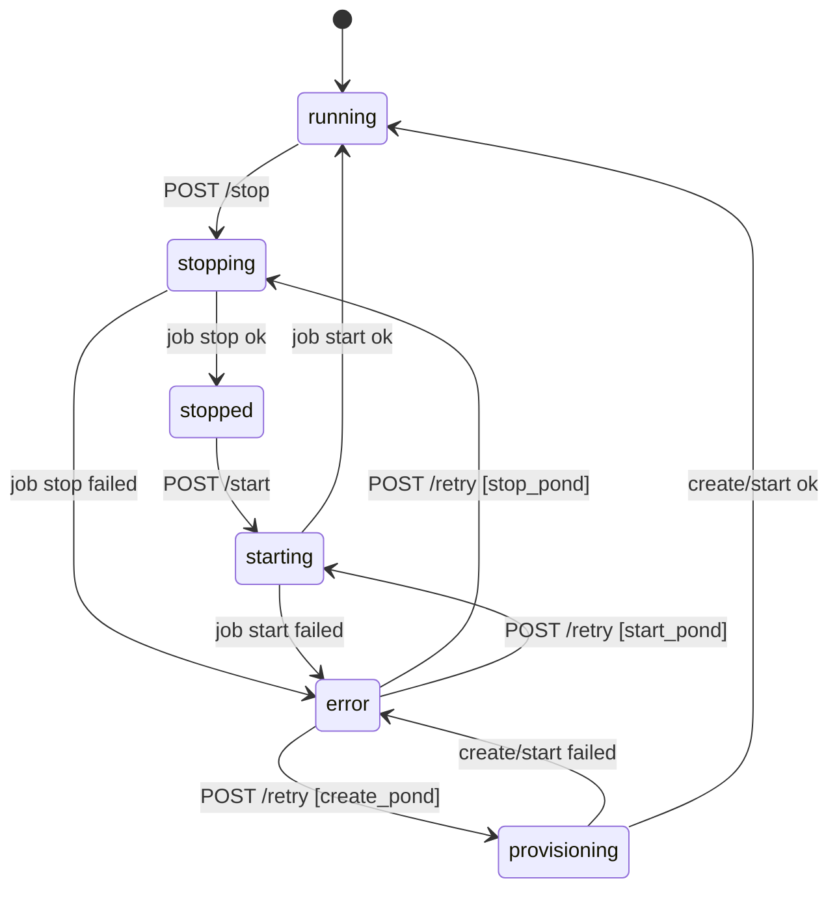

# Pond stop / start statechart (CCR #131)

Agreed public stop/start flow. TLC-checked before product code.

| File | Role |
|------|------|
| `pond-stop-start.mmd` | Hand chart (matches approved CCR comment) |
| `PondStopStart.tla` + `.cfg` + `.map.mjs` | TLC model + reader labels |
| `chart.mmd` / `report.md` / `tlc.out` / `summary.json` | Last TLC run |

Readable diagram for reviewers:

- Mermaid: `docs/architecture/diagrams/21-pond-stop-start.mmd`
- PNG: `docs/architecture/diagrams/21-pond-stop-start.png`
- SVG: `docs/architecture/diagrams/21-pond-stop-start.svg`

## Happy / error transitions



Recovery from `error` is **only** `POST /retry`, which requeues the last
failed job type (`stop_pond` → stopping, `start_pond` → starting,
`create_pond` → provisioning). `POST /start` from `observed=failed` stays
`409 pond_busy` (start needs `observed=stopped`).

`stopping` / `starting` are **UI phases** (`desired ≠ observed` + job in flight).
The observed enum does not gain new values.

## 409 `pond_busy` (no phase change)

These POSTs stay in the current phase and return `409 pond_busy`. They are not
drawn as arrows on the chart (self-loops would hide the real transitions).

| Current phase | Request | Why |
|---|---|---|
| `stopped` | `POST /stop` | stop needs `observed=running` |
| `running` | `POST /start` | start needs `observed=stopped` |
| `error` (`observed=failed`) | `POST /start` or `/stop` | start needs `observed=stopped`; stop needs `running` — use `/retry` |
| `stopping` | `POST /stop` or `/start` | job already in flight |
| `starting` | `POST /stop` or `/start` | job already in flight |
| any with active `queued\|running` job | either | `jobs_one_active` / double-click |

Also: `404 pond_not_found`, `403 not_owner`, `503 node_unavailable`.
SQL on a non-running pond keeps `409 pond_not_running` (r2 A4).

## Regenerate

```bash
export PATH="$HOME/.local/bin:$PATH"
node <statechart-skill>/scripts/statechart PondStopStart.tla \
  --view PondStopStart.map.mjs --out /tmp/pond-stop-start-out
```

Invariant that must stay green: `TypeOK` (6 chart phases × `last_fail`;
last TLC: 11 distinct model states, 0 rule breaks).
