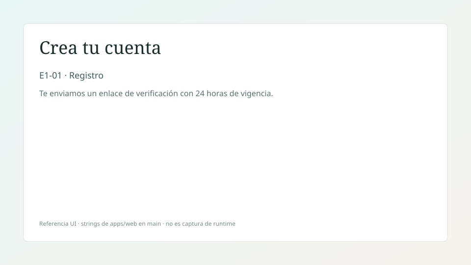
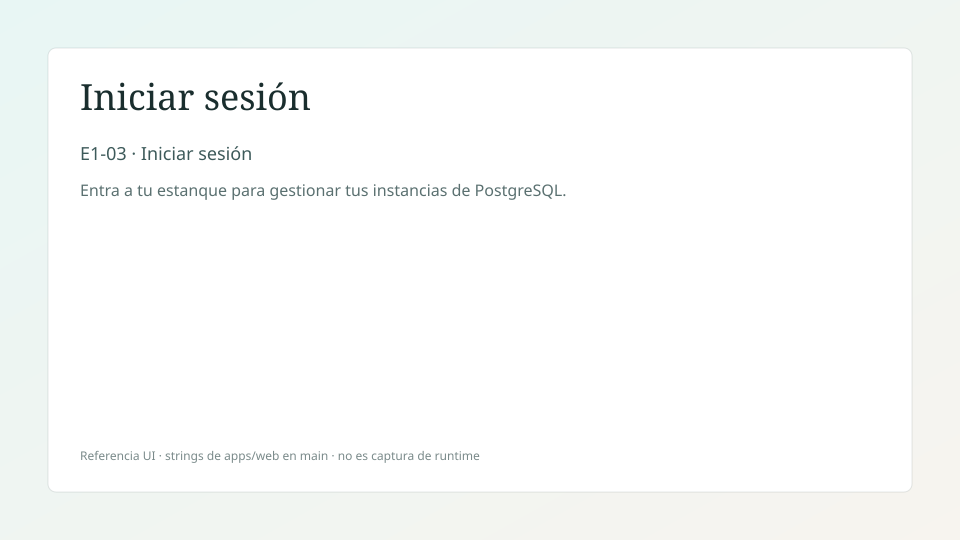
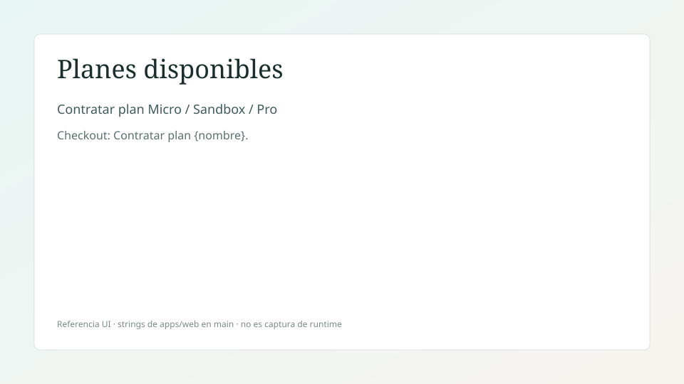
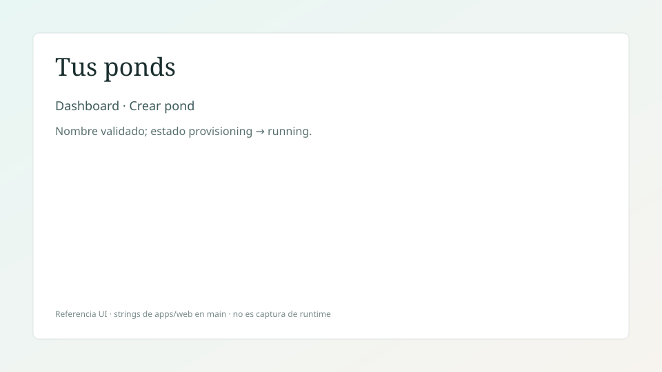
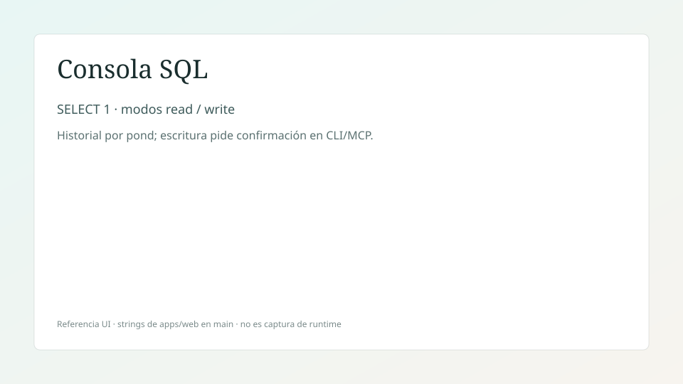
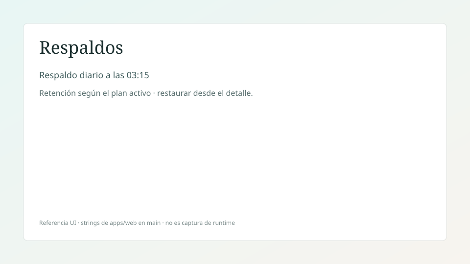
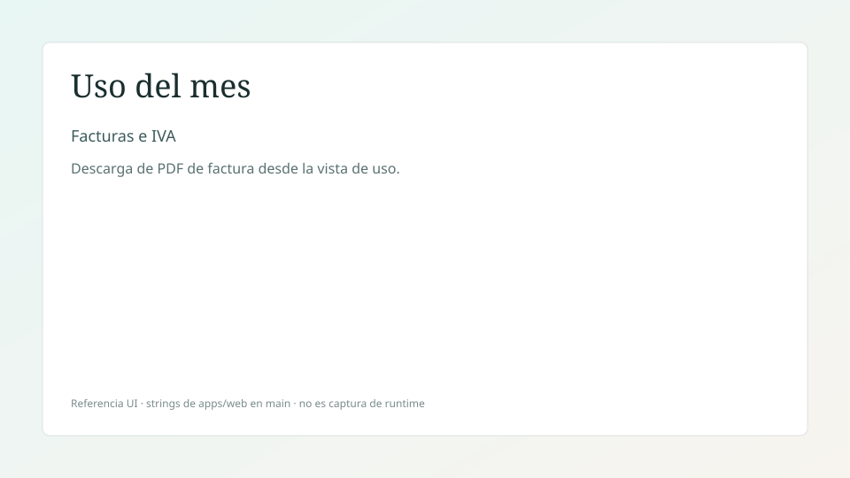
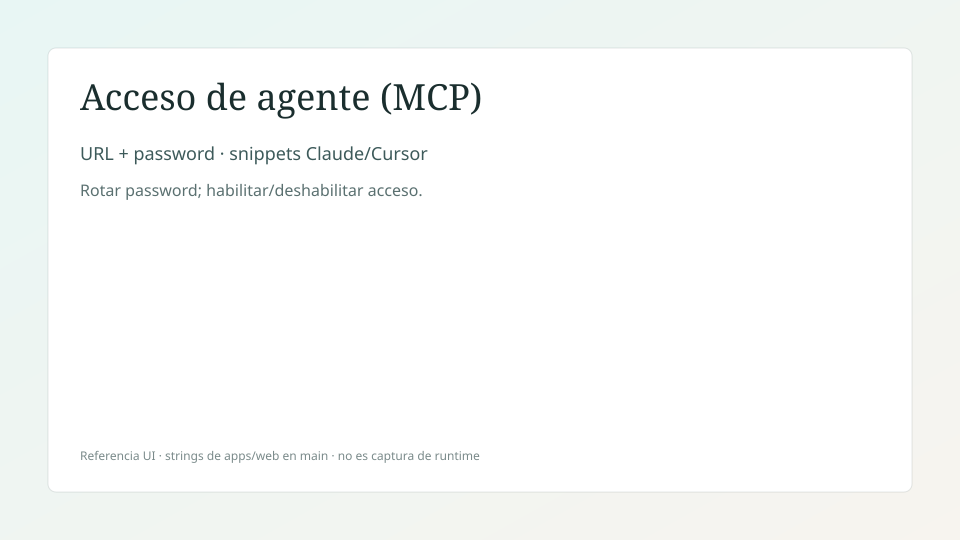

# Manual de usuario de KoiCloud

Guía en español del flujo de producto en la Web. Las capturas de
[`manual-usuario/img/`](./manual-usuario/img/) reproducen los **textos reales** de
`apps/web` en `main` (no mockups futuros). No son pantallazos de un runtime
grabado en este PR; W2 puede marcar desfases de layout al revisar.

**Credenciales demo** (tras `make seed`): `demo@koicloud.dev` / `Sup3rSegura!2026`
(ver `README.md`).

## Exportar a PDF

Mismo mecanismo que el manual técnico (W4-11):

```bash
pandoc docs/manual-usuario.md -o /tmp/manual-usuario.html \
  --standalone --resource-path=docs
# luego imprimir a PDF desde el navegador, o:
google-chrome --headless --disable-gpu --no-sandbox \
  --print-to-pdf=/tmp/manual-usuario.pdf /tmp/manual-usuario.html
```

---

## 1. Registro

1. Abrí `/register`.
2. Completá correo, nombre y contraseña.
3. Enviá el formulario **Crea tu cuenta**.
4. La app muestra **Revisa tu correo** (enlace de verificación, 24 h).



---

## 2. Login

1. Abrí `/login` (también desde la landing **Iniciar sesión**).
2. Ingresá correo y contraseña.
3. Pulsá **Iniciar sesión**.
4. Entrás al dashboard de ponds.



Recuperación: **Recuperar acceso** → enlace de un solo uso → **Restablecer contraseña**.

---

## 3. Contratación

1. Entrá a **Planes disponibles**.
2. Elegí Sandbox, Micro o Pro.
3. En el diálogo **Contratar plan …** confirmá el pago simulado.
4. Queda la suscripción activa y podés crear ponds según el cupo del plan.



---

## 4. Ponds

1. En el dashboard, **Crear pond**.
2. Elegí un nombre válido (reglas de la UI).
3. Confirmá **Crear pond**.
4. El detalle muestra estados hasta `running` y la cadena de conexión.



---

## 5. Consola SQL

1. Desde el detalle del pond, abrí la consola SQL.
2. Escribí una consulta (p. ej. `SELECT 1`).
3. Elegí modo lectura o escritura y ejecutá.
4. Revisá resultados e historial en el panel lateral.



---

## 6. Backups

1. En el pond, abrí **Respaldos**.
2. La UI indica respaldo diario (03:15) y retención del plan.
3. Podés disparar restauración desde un respaldo listado (con confirmación).



---

## 7. Uso y facturas

1. Abrí la vista **Uso del mes**.
2. Revisá consumo por pond y el listado de facturas.
3. Descargá el PDF de una factura (incluye IVA en el flujo de billing).



---

## 8. Agente (MCP)

1. Abrí la página de acceso de agente.
2. Copiá la URL `/mcp` y la password (revelar / rotar).
3. Pegá el snippet en Claude Desktop o Cursor.
4. Podés deshabilitar el acceso sin borrar el slug.



Fallback de demo sin LLM: `python3 scripts/demo-mcp-replay.py --simulate-chat`
(ver runbook cuando aterrice W4-09).

---

## Notas para W2

- Revisá que tipografía, densidad y estados (cargando / vacío / error) coincidan con
  `docs/visual-guidelines.md`.
- Si una captura SVG se desfasó respecto a la UI, reemplazala por un pantallazo real
  en `docs/manual-usuario/img/` y actualizá este archivo en el mismo PR de corrección.
