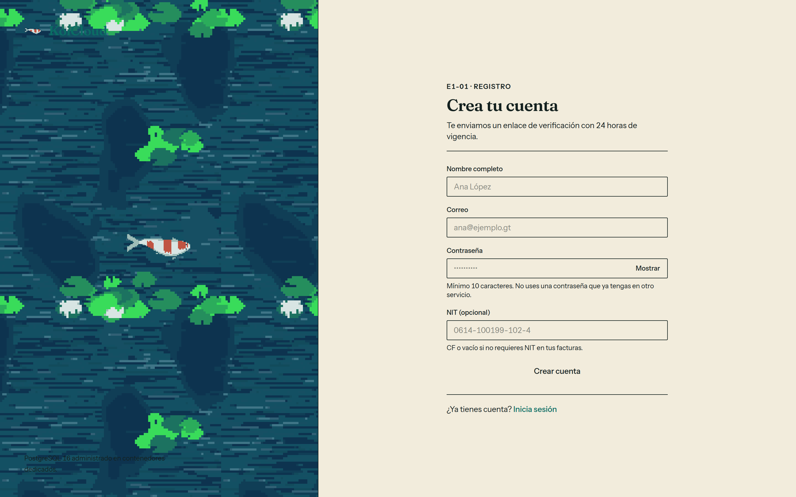
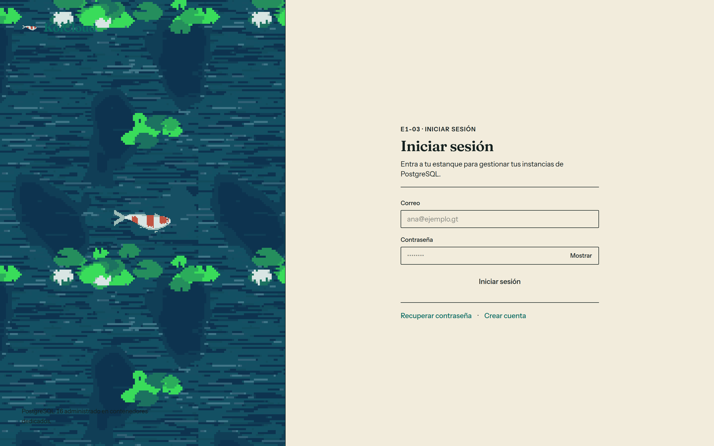
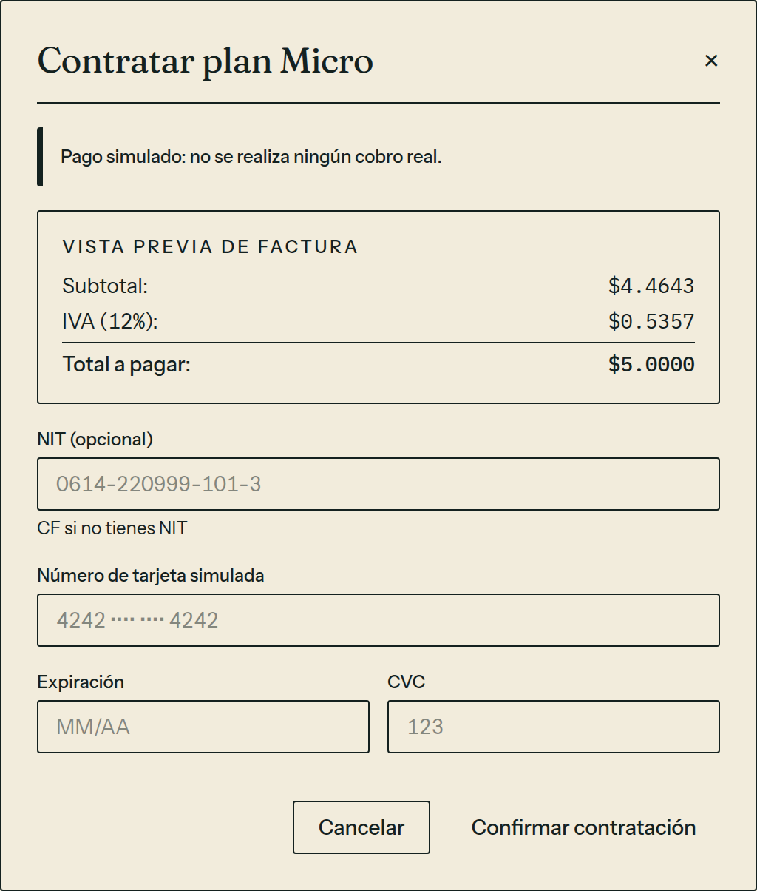
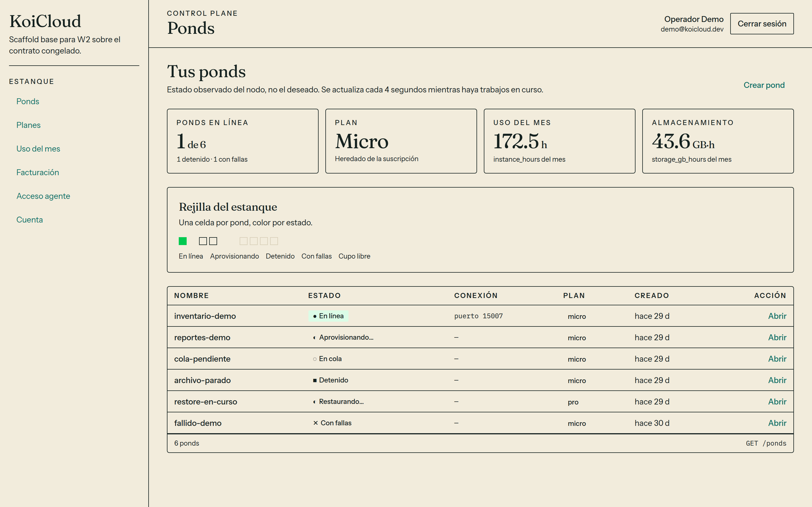
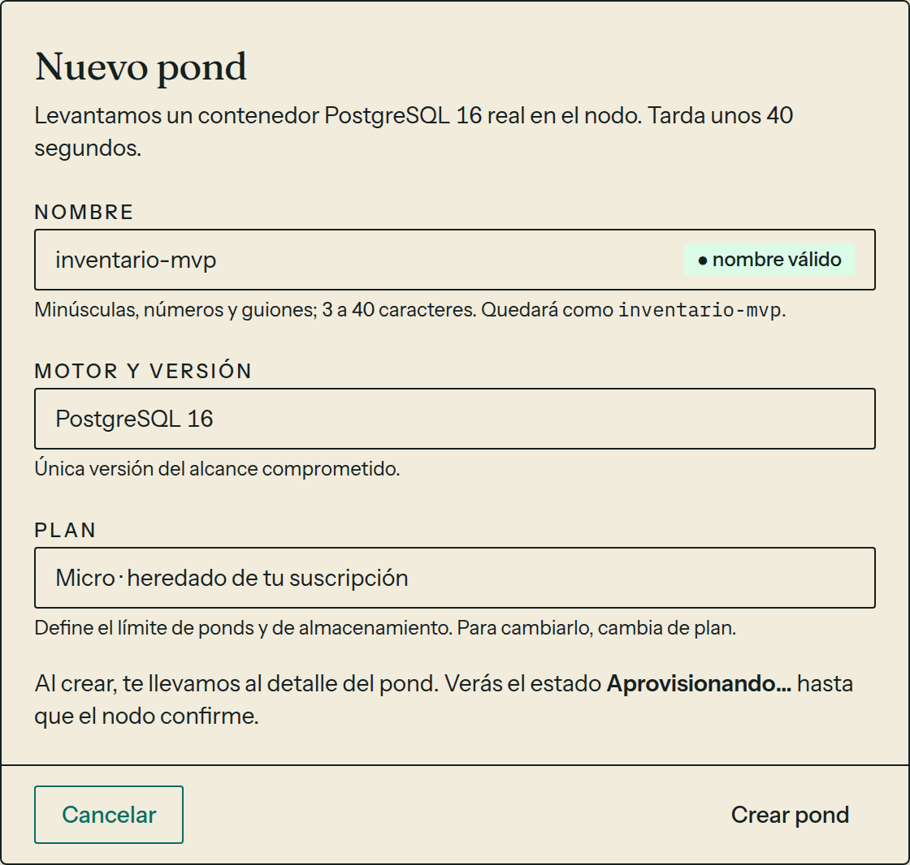
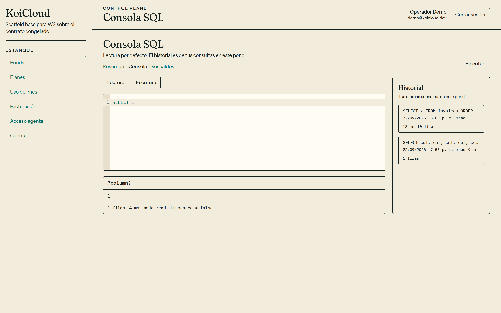
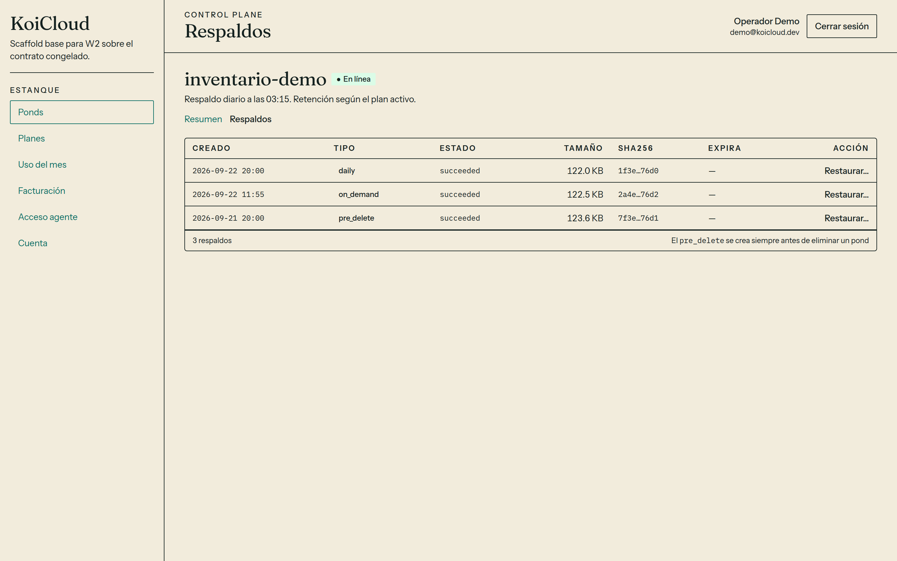
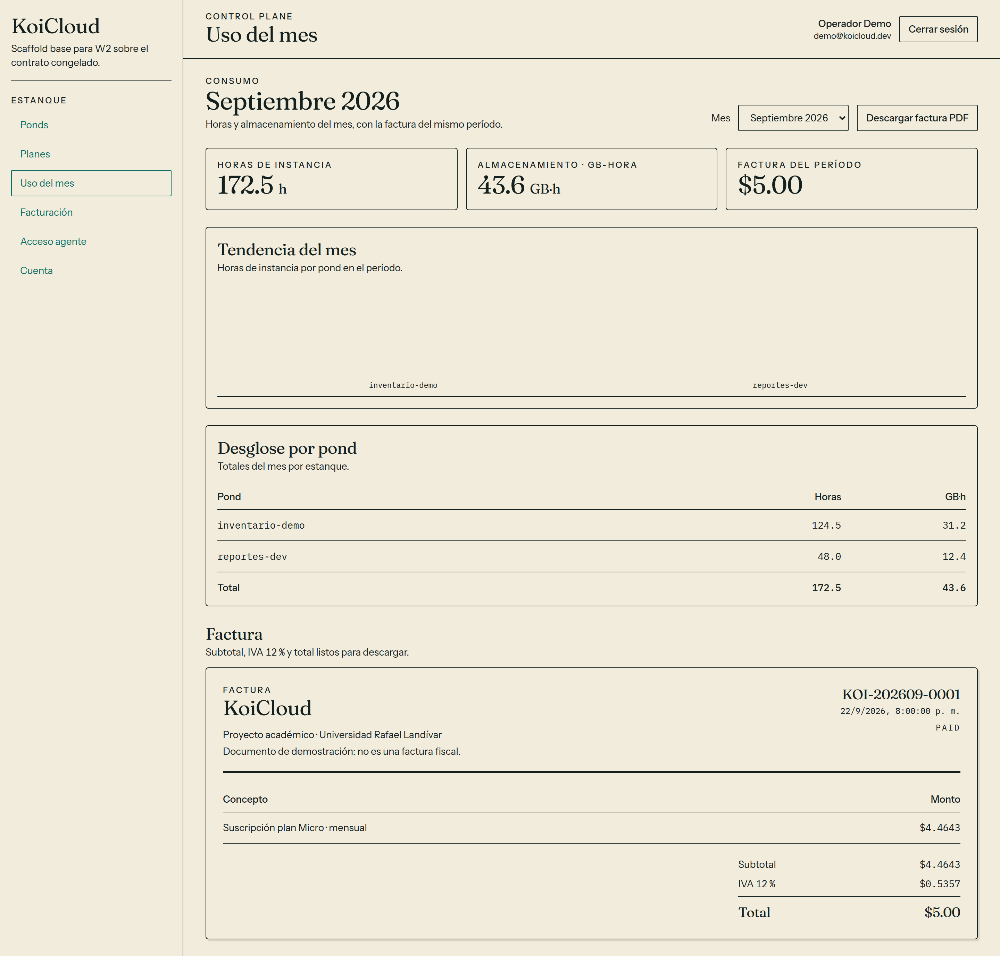
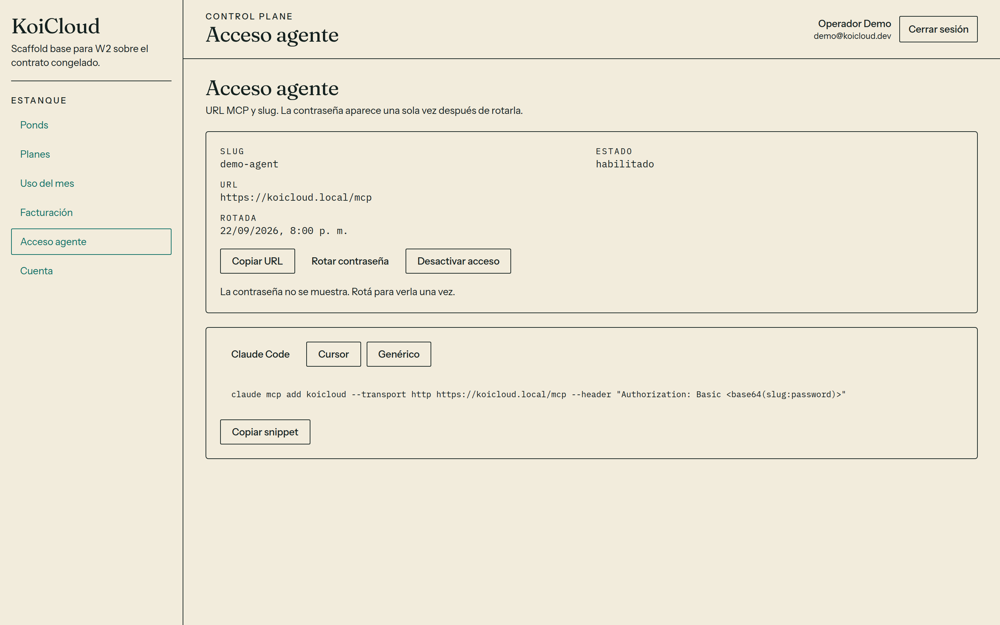

# Manual de usuario

Esta guía recorre KoiCloud en la web. Cada sección termina en la pantalla que vas a ver.

Las figuras salen de `apps/web` en `main`, servida con `pnpm dev` y `VITE_ENABLE_MOCKS=true`. Los textos son los de esa interfaz. Las filas son los datos de demostración de ese modo, con la cuenta Operador Demo.

Para la API local, `make seed` crea `demo@koicloud.dev` con la contraseña `Sup3rSegura!2026`.

En el shell, bajo el nombre, se lee "Scaffold base para W2 sobre el contrato congelado." La barra **Estanque** lista **Ponds**, **Planes**, **Uso del mes**, **Facturación**, **Acceso agente** y **Cuenta**.

## Registra una cuenta

Abre `/register`. También puedes llegar desde **Crear cuenta** en la portada.

1. Completa **Nombre completo**.
2. Completa **Correo**.
3. Completa **Contraseña**. El mínimo es 10 caracteres. **Mostrar** enseña el texto y **Ocultar** lo tapa.
4. Completa **NIT (opcional)** si la factura lo necesita. La ayuda dice "CF o vacío si no requieres NIT en tus facturas."
5. Elige **Crear cuenta**.

La pantalla siguiente se titula **Revisa tu correo**. El enlace vence en 24 horas. El estado queda `email_verified = false` hasta que abras ese enlace.

Abre el enlace. **Verificar correo** pasa a `email_verified = true`. Elige **Continuar a iniciar sesión**.



## Inicia sesión

Abre `/login`. En la portada, **Iniciar sesión** abre esa misma ruta.

1. Completa **Correo**.
2. Completa **Contraseña**.
3. Elige **Iniciar sesión**.

La web abre `/app`, en **Tus ponds**. Arriba a la derecha ves tu nombre, tu correo y **Cerrar sesión**.

**Recuperar contraseña** abre **Recuperar acceso**. Si el correo existe, el enlace de un solo uso vence en 1 hora. **Crear cuenta** vuelve al registro.



## Contrata un plan

Entra con la sesión abierta. Elige **Planes**.

La página se titula **Planes disponibles**. Hay tres planes.

- **Sandbox** cuesta $0 por 10 minutos. Incluye 1 pond y 1 GB. La validez es de 10 minutos.
- **Micro** lleva la marca **Recomendado**. Cuesta $5 al mes. Incluye 1 pond, 1 GB y respaldos diarios por 7 días.
- **Pro** cuesta $0.02 por hora. Incluye hasta 10 ponds y 20 GB. Los respaldos diarios se guardan 30 días.

Elige **Elegir plan Micro**. El botón abre el diálogo **Contratar plan Micro**.

El aviso dice "Pago simulado: no se realiza ningún cobro real."

**Vista previa de factura** muestra subtotal, **IVA (12%)** y total. Para Micro el total es $5.0000.

1. Completa **NIT (opcional)**. La ayuda dice "CF si no tienes NIT".
2. Completa **Número de tarjeta simulada**, **Expiración** y **CVC**.
3. Elige **Confirmar contratación**.

La web abre **Nuevo pond**. **Cancelar** cierra el diálogo y te deja en el catálogo.



## Trabaja con los ponds

Elige **Ponds**. El título es **Tus ponds**.

Bajo el título se lee "Estado observado del nodo, no el deseado. Se actualiza cada 4 segundos mientras haya trabajos en curso."

Los cuatro indicadores son **Ponds en línea**, **Plan**, **Uso del mes** y **Almacenamiento**.

**Rejilla del estanque** usa una celda por pond, con color por estado. La leyenda es **En línea**, **Aprovisionando**, **Detenido**, **Con fallas** y **Cupo libre**.

La tabla tiene **Nombre**, **Estado**, **Conexión**, **Plan**, **Creado** y **Acción**. **Abrir** entra al detalle de ese pond.



Para crear uno, elige **Crear pond**.

1. Escribe el **Nombre**. Solo minúsculas, números y guiones, de 3 a 40 caracteres. Si el nombre sirve, aparece **nombre válido**.
2. **Motor y versión** muestra **PostgreSQL 16**. La ayuda dice "Única versión del alcance comprometido."
3. **Plan** muestra el plan heredado de tu suscripción.
4. Elige **Crear pond**. **Cancelar** vuelve al listado.

Al crear, la web abre el detalle y muestra **Aprovisionando…** hasta que el nodo confirma. **Cadena de conexión** lista **Host**, **Puerto**, **Usuario**, **Base**, **Contraseña** y **URI**. **Revelar** muestra la contraseña. **Copiar URI** copia la cadena.



## Ejecuta SQL

En el detalle del pond, elige **Consola**.

El título es **Consola SQL**. **Lectura** es el modo inicial. **Escritura** muestra el aviso "Modo escritura: las sentencias modifican datos reales."

1. Escribe la sentencia en el editor.
2. Elige **Ejecutar**.
3. Lee la tabla de resultados. La barra inferior muestra las filas, los milisegundos, el modo y si el resultado quedó truncado.

**Historial** lista tus últimas consultas en ese pond.



## Restaura un respaldo

En el detalle, elige **Respaldos**.

El texto dice "Respaldo diario a las 03:15. Retención según el plan activo."

La tabla tiene **Creado**, **Tipo**, **Estado**, **Tamaño**, **sha256**, **Expira** y **Acción**. Un respaldo en estado `succeeded` ofrece **Restaurar…**.

El pie recuerda que el tipo `pre_delete` se crea siempre antes de eliminar un pond.

1. Elige **Restaurar…** en la fila.
2. Lee el aviso. La restauración borra los datos actuales del pond y los reemplaza por el respaldo. No puedes deshacerla.
3. Escribe el nombre del pond en **Escribe el nombre del pond para confirmar**. Tiene que coincidir con el nombre esperado.
4. Elige **Restaurar pond**.

La página avisa "Restauración encolada", con el id del job y el estado `queued`.



## Revisa el uso del mes

Elige **Uso del mes**.

El selector **Mes** cambia el período. Los indicadores son **Horas de instancia**, **Almacenamiento · GB-hora** y **Factura del período**.

**Tendencia del mes** compara las horas por pond. **Desglose por pond** lista horas y GB·h.

**Factura** muestra **Subtotal**, **IVA 12 %** y **Total**. El papel dice "Documento de demostración: no es una factura fiscal." **Descargar factura PDF** baja el archivo de ese mes. Si el mes no tiene factura, ese botón permanece deshabilitado.

**Facturación** está en la barra, en otra pantalla. Esta guía no la recorre.



## Conecta el agente

Elige **Acceso agente**.

La página muestra **Slug**, **Estado**, **URL** y **Rotada**. **Copiar URL** copia la dirección MCP.

La contraseña no se muestra. Elige **Rotar contraseña** para verla una vez. El aviso se titula **Contraseña de un solo uso**. **Copiar contraseña** la copia. **Ocultar** la cierra.

**Desactivar acceso** pasa el estado a deshabilitado. **Activar acceso** lo vuelve a habilitar.

Los snippets son **Claude Code**, **Cursor** y **Genérico**. **Copiar snippet** copia el bloque de la pestaña activa. Sin rotar, el snippet deja la contraseña como marcador.



## Exporta este manual a PDF

El mecanismo es el de [`manual-tecnico.md`](manual-tecnico.md). `pandoc` genera el archivo.

Desde la raíz del monorepo, con XeLaTeX:

```bash
pandoc docs/manual-usuario.md \
  -o docs/manual-usuario.pdf \
  --from markdown \
  --pdf-engine=xelatex \
  -V geometry:margin=2cm \
  --resource-path=docs
```

Si no tienes XeLaTeX, genera el HTML con el segundo comando. Ábrelo en el navegador. Elige Imprimir y guarda el resultado como PDF.

```bash
pandoc docs/manual-usuario.md \
  -o docs/manual-usuario.html \
  --from markdown \
  --standalone \
  --resource-path=docs
```

No subas el HTML ni el PDF generados. Revisa que las figuras no se corten.
