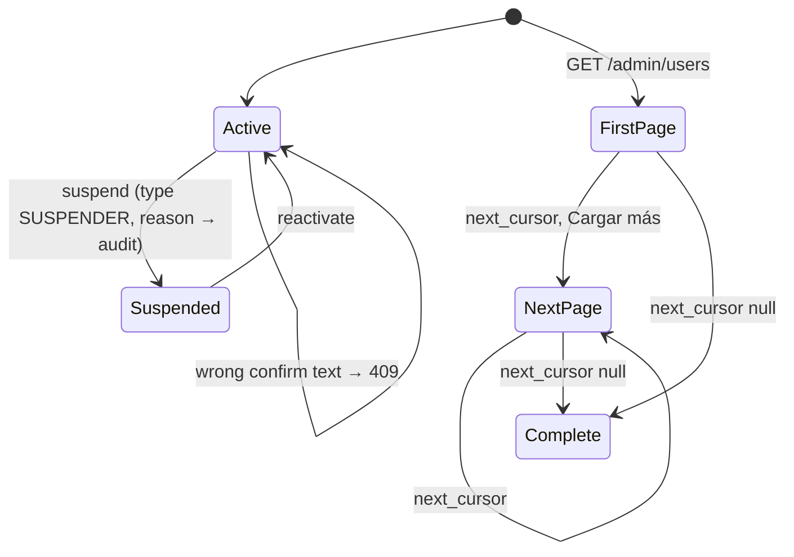

# L2 · 7 Admin
Code: `apps/api/app/modules/admin/service.py`, `commands/admin.py`, web `features/admin/`.

| # | From | Event | Guard | To | Side effect | e2e test |
|---|---|---|---|---|---|---|
| D1 | Active | suspend | admin, text=SUSPENDER | Suspended | audit `suspend_user` + reason; tokens revoked; agent blocked | `admin: suspended user loses api access` |
| D2 | Active | suspend | wrong text | Active | 409 | `admin: suspend needs typed confirm` |
| D3 | Suspended | reactivate | admin | Active | audit | `admin: reactivate restores login` |
| D4 | — | any /admin/* | non-admin | — | 403 admin_only | `admin: non-admin gets 403` |
| D5 | — | totals | admin | — | global counts | `admin: totals are global` |
| D6 | — | GET /admin/users | admin, no cursor | FirstPage | 50 rows, or fewer on the last page. Order is `created_at desc, id desc`. Active plan comes from the same query | `test_admin_list_users_returns_three_pages_for_120_users` |
| D7 | FirstPage | Cargar más | `next_cursor` present | NextPage | appends the next page. `limit` above 200 is 422 | `test_admin_list_users_rejects_limit_above_200` |
| D8 | NextPage | last page | `next_cursor` null | Complete | the button goes away | `admin users list pages and suspend survives reload` |
