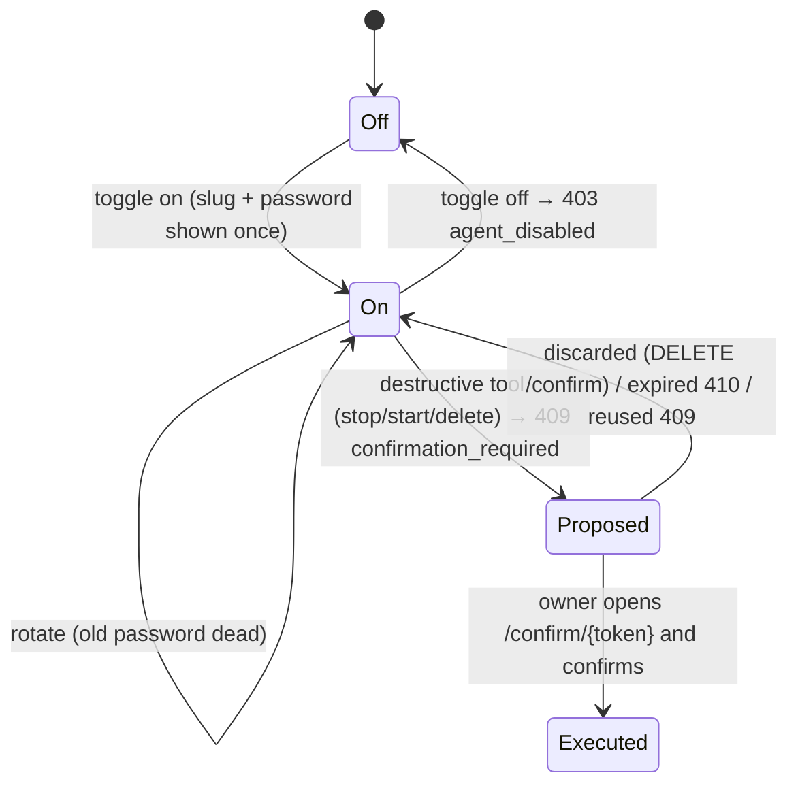

# L2 · 6 Agent access & confirmations
Code: `apps/api/app/modules/agent_access/service.py`, `commands/confirmations.py`, `mcp/server.py`, `apps/cli`, web `features/agent-access/`, `features/confirm/`.

| # | From | Event | Guard | To | Side effect | e2e test |
|---|---|---|---|---|---|---|
| G1 | Off | toggle on | logged in | On | credentials | `agent: enable shows credentials` |
| G2 | On | rotate | — | On | old password 401 | `agent: rotate invalidates old password` |
| G3 | On | toggle off | — | Off | calls 403 | `agent: disabled agent rejected` |
| G4 | On | destructive tool | — | Proposed | confirm token | `agent: stop needs web confirm` |
| G5 | Proposed | confirm | owner active, token fresh | Executed | action runs | `agent: confirm executes action` |
| G6 | Proposed | discard/expire/reuse | — | On | 404/410/409 | `agent: stale confirm rejected` |
| G7 | On | any call | owner suspended | On | must 403 | `agent: suspended owner blocks agent` |
