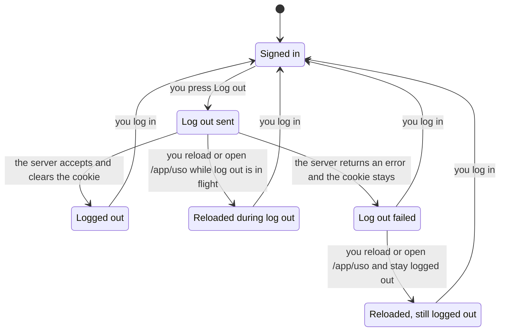

# L2 · 1 Auth & session
Code: `apps/api/app/commands/auth.py`, `core/auth.py`, `core/security.py` (access 15 min), web `lib/auth-store.ts`, `lib/logged-out.ts`, `app/session-boot-gate.tsx`, `api/client.ts`.

```mermaid
stateDiagram-v2
  [*] --> Registered: POST /auth/register (email sent)
  Registered --> Verified: POST /auth/verify (token)
  Registered --> Registered: login → 403 email_not_verified
  Verified --> LoggedIn: POST /auth/login
  Verified --> Verified: bad password → 401 invalid_credentials
  LoggedIn --> LoggedIn: access expires → POST /auth/refresh (rotates)
  LoggedIn --> LoggedIn: page reload → POST /auth/refresh (httpOnly koi_refresh) restores session
  LoggedIn --> Verified: refresh fails → session cleared, login
  LoggedIn --> Verified: POST /auth/logout accepted (cookie cleared; marker stays until the next login)
  LoggedIn --> LogoutFailed: POST /auth/logout fails (5xx or network). Marker was stored first. Cookie stays.
  LogoutFailed --> LogoutFailed: reload or /app/uso skips refresh, retries logout, stays on login
  LogoutFailed --> LoggedIn: successful login clears the marker
  Verified --> ResetPending: POST /auth/forgot
  ResetPending --> Verified: POST /auth/reset
  LoggedIn --> Suspended: admin suspends (main: tokens keep working)
  Suspended --> Verified: admin reactivates
  Suspended --> Suspended: login/refresh → 403 account_suspended
```

| # | From | Event | Guard | To | Side effect | e2e test |
|---|---|---|---|---|---|---|
| A1 | — | register | email free, pwd ok | Registered | verify email (Resend) | `auth: register sends verification` |
| A2 | Registered | verify | token valid | Verified | `email_verified_at` | `auth: verify link activates` |
| A3 | Registered | login | — | Registered | 403 `email_not_verified` | `auth: unverified login rejected` |
| A4 | Verified | login | ok creds, active | LoggedIn | access+refresh | `journey: login lands on pond list` |
| A5 | Verified | login | bad creds | Verified | 401 | `journey: bad login stays on login` |
| A6 | LoggedIn | access expired | refresh valid | LoggedIn | rotate tokens | `auth: expired access refreshes silently` |
| A7 | LoggedIn | logout | server accepts | Verified | marker stored before the request; cookie cleared; only a later login clears the marker | `journey: logout returns to login` |
| A13 | LoggedIn | logout | 5xx or network | LogoutFailed | marker stays; toast that the server session may remain; cookie stays | `journey: msw logout failure still returns to login` |
| A14 | LogoutFailed | reload or `/app/uso` | marker set | LogoutFailed | boot skips refresh and retries logout; the screen stays login | `journey: msw logout failure still returns to login` |
| A15 | LogoutFailed | login | credentials ok | LoggedIn | marker cleared | `journey: msw logout failure still returns to login` |
| A8 | LoggedIn | reload | — | LoggedIn | session restored | `journey: reload keeps session` |
| A9 | Verified | forgot → reset | token valid | Verified | email, password changed | `auth: password reset flow` |
| A10 | LoggedIn | admin suspends | — | Suspended | pond API must 403 | `admin: suspended user loses api access` |
| A11 | Suspended | login/refresh | — | Suspended | 403 `account_suspended` | `auth: suspended login rejected` |
| A12 | Suspended | reactivate | — | Verified | — | `admin: reactivate restores login` |

## Logout failure

Model: [`../model/LogoutSession.tla`](../model/LogoutSession.tla). `Fixed = TRUE` is the design below. `Fixed = FALSE` is the client at `924c07e`.

The design chart holds `StaysLoggedOut`, `NoSessionAfterFailedLogout`, `FailureIsWarned`, and `LoginClearsMarker`.



The chart hides two kinds of step. A reload that stays on `Logged out` after the cookie is already gone returns no label from the view. A second reload on `Reloaded, still logged out` or `Reloaded during log out` stays in that label, so it is not drawn.

At `924c07e` the same rules do not hold. TLC found these shortest paths. Replay against `logoutSession` in `apps/web/src/api/hooks/auth.ts` and `SessionBootGate` in `apps/web/src/app/session-boot-gate.tsx`.

`FailureIsWarned`. After Log out, the screen says the server session may still be active when the cookie survived. This breaks on `Log out failed`.

0. Signed in
1. you press Log out. Log out sent
2. the server returns an error and the cookie stays. Log out failed

The handler swallows the error, clears the in-memory session, and shows login. It does not warn. The state is login with an empty memory, so `StaysLoggedOut` and `NoSessionAfterFailedLogout` still hold there.

`StaysLoggedOut`. After Log out has settled, or while it is in flight and the user reloads, the next page is login and the access token is gone. This breaks on `Signed back in`.

0. Signed in
1. you press Log out. Log out sent
2. you reload or open /app/uso and the refresh signs you in. Signed back in

The click stores nothing before `POST /auth/logout`. A reload drops the memory session. Boot calls `restoreSession`, the cookie is still valid, and refresh returns 200.

`NoSessionAfterFailedLogout`. A failed logout is not undone by the next reload or by opening `/app/uso`. This also ends on `Signed back in`.

0. Signed in
1. you press Log out. Log out sent
2. the server returns an error and the cookie stays. Log out failed
3. you reload or open /app/uso and the refresh signs you in. Signed back in

MSW returns 500 for `sessionStorage["koi-mock-logout-fails"] === "1"` and does not clear `koi_refresh`. Boot then refreshes that cookie.

`Log out sent` may break `FailureIsWarned` and `NoSessionAfterFailedLogout`. The first press does not. A later press, after the user was signed back in, still has the failed logout recorded, and those two rules break in that copy of the state.

`LoginClearsMarker` holds in the as-is run because that client never stores a marker. The rule has nothing to catch until the marker exists.

The model leaves out viewport width, the 15-minute access JWT, 4xx responses, and a login that overlaps the quiet retry. A 5xx response and a dropped connection are one step.

Regenerate into a new output folder. `docs/statechart/model/check.sh` runs `LogoutSessionFixed.cfg` with the other models and expects `PASS`. `LogoutSessionAsIs.cfg` is expected to fail the three rules above.

```sh
cd docs/statechart/model
TLA2TOOLS="$PWD/tla2tools.jar" JAVA=/usr/bin/java \
  <statechart-skill>/scripts/statechart "$PWD/LogoutSession.tla" \
  --config "$PWD/LogoutSessionAsIs.cfg" \
  --view "$PWD/logout.view.ts" \
  --out /tmp/logout-as-is
```
