# L2 · 1 Auth & session
Code: `apps/api/app/commands/auth.py`, `core/auth.py`, `core/security.py` (access 15 min), web `lib/auth-store.ts`, `app/session-boot-gate.tsx`, `api/client.ts`.

```mermaid
stateDiagram-v2
  [*] --> Registered: POST /auth/register (email sent)
  Registered --> Verified: POST /auth/verify (token)
  Registered --> Registered: login → 403 email_not_verified
  Verified --> LoggedIn: POST /auth/login
  Verified --> Verified: bad password → 401 invalid_credentials
  LoggedIn --> LoggedIn: access expires → POST /auth/refresh (rotates)
  LoggedIn --> LoggedIn: page reload → POST /auth/refresh (httpOnly koi_refresh) restores session
  LoggedIn --> Verified: refresh fails → session cleared, login
  LoggedIn --> Verified: POST /auth/logout (refresh revoked; access JWT lives ≤15 min) 
  Verified --> ResetPending: POST /auth/forgot
  ResetPending --> Verified: POST /auth/reset
  LoggedIn --> Suspended: admin suspends (main: tokens keep working)
  Suspended --> Verified: admin reactivates
  Suspended --> Suspended: login/refresh → 403 account_suspended
```

| # | From | Event | Guard | To | Side effect | e2e test |
|---|---|---|---|---|---|---|
| A1 | — | register | email free, pwd ok | Registered | verify email (Resend) | `auth: register sends verification` |
| A2 | Registered | verify | token valid | Verified | `email_verified_at` | `auth: verify link activates` |
| A3 | Registered | login | — | Registered | 403 `email_not_verified` | `auth: unverified login rejected` |
| A4 | Verified | login | ok creds, active | LoggedIn | access+refresh | `journey: login lands on pond list` |
| A5 | Verified | login | bad creds | Verified | 401 | `journey: bad login stays on login` |
| A6 | LoggedIn | access expired | refresh valid | LoggedIn | rotate tokens | `auth: expired access refreshes silently` |
| A7 | LoggedIn | logout | — | Verified | refresh revoked; pond API must 401 | `auth: logout kills pond api access` |
| A8 | LoggedIn | reload | — | LoggedIn | session restored | `journey: reload keeps session` |
| A9 | Verified | forgot → reset | token valid | Verified | email, password changed | `auth: password reset flow` |
| A10 | LoggedIn | admin suspends | — | Suspended | pond API must 403 | `admin: suspended user loses api access` |
| A11 | Suspended | login/refresh | — | Suspended | 403 `account_suspended` | `auth: suspended login rejected` |
| A12 | Suspended | reactivate | — | Verified | — | `admin: reactivate restores login` |
