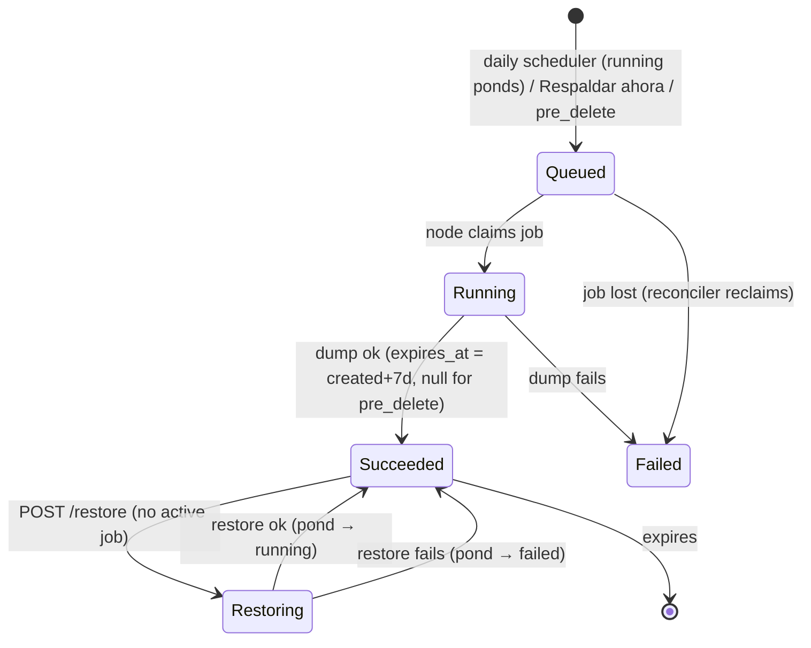

# L2 · 3 Backups
Code: `apps/api/app/modules/backups/service.py`, node-agent `handlers/backup_pond.py`, `restore_pond.py`, web `features/ponds/backups-page.tsx`.

| # | From | Event | Guard | To | Side effect | e2e test |
|---|---|---|---|---|---|---|
| B1 | — | Respaldar ahora | pond running, no job | Queued | job backup_pond | `lifecycle: backup now adds a row` |
| B2 | — | daily scheduler | desired=observed=running, no job | Queued | — | `backups: daily scheduler skips busy pond` |
| B3 | Queued→Running | node claims | — | Running | — | (covered by B1) |
| B4 | Running | ok | — | Succeeded | `expires_at` set | `backups: expira column filled` |
| B5 | Running | fails | — | Failed | pond stays online | `lifecycle: failed backup keeps pond online` |
| B6 | Succeeded | restore | backup of this pond, no job | Restoring | pond restoring | `lifecycle: restore from backup` |
| B7 | — | restore other pond's backup | — | — | 404 | `backups: restore foreign backup rejected` |
| B8 | — | delete pond | — | Queued (pre_delete) | then delete job | `lifecycle: delete with pre_delete backup` |
