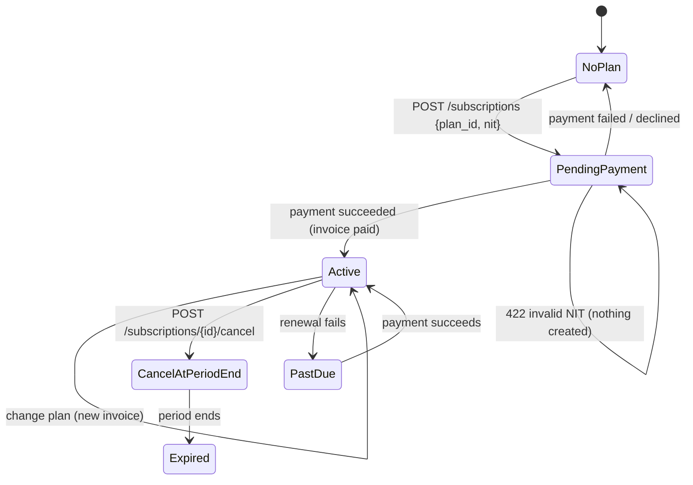

# L2 · 5 Usage, billing & plans
Code: `apps/api/app/modules/billing/` (service, plan_pricing, payments/simulated, invoice_pdf), `modules/metering/`, web `features/plans/`, `features/uso/`.

Metering: node samples → `aggregate_day` → `instance_hours`, `storage_gb_hours` → `GET /usage`; Pro hourly at `PRO_HOURLY_UNIT_PRICE_USD`.

| # | From | Event | Guard | To | Side effect | e2e test |
|---|---|---|---|---|---|---|
| M1 | NoPlan | subscribe | NIT ok, card ok | PendingPayment→Active | invoice with NIT snapshot | `checkout: valid nit and card issues invoice` |
| M2 | NoPlan | subscribe | NIT bad | NoPlan | 422 | `checkout: invalid nit shows error` |
| M3 | PendingPayment | declined | — | NoPlan | no invoice paid | `checkout: declined card shows error` |
| M4 | Active | change plan | — | Active | new invoice | `billing: change plan from uso y facturacion` |
| M5 | Active | cancel | — | CancelAtPeriodEnd | — | `billing: cancel at period end` |
| M6 | CancelAtPeriodEnd | period ends | — | Expired | ponds blocked by plan_required | `billing: expired plan blocks create` |
| M7 | — | daily aggregate | pond deleted | — | no hours after delete | `metering: deleted pond stops accruing` |
| M8 | — | price shown | — | — | plans = checkout = /app/uso = API | `pricing: plans and checkout match api` |
