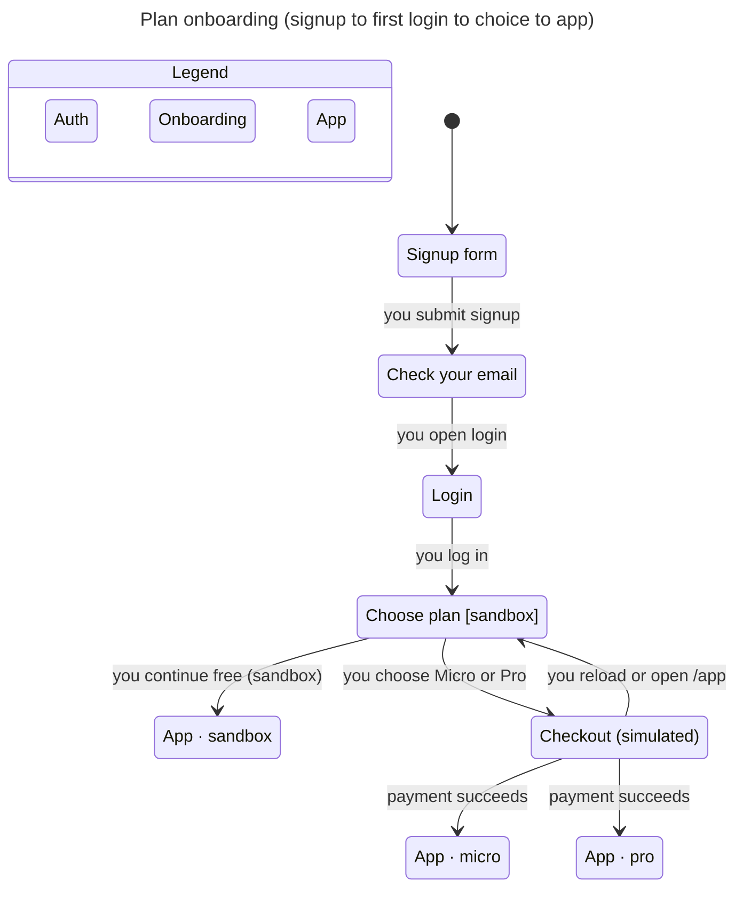

# L2 · Plan onboarding (W1-54)

Code: `apps/api/app/commands/auth.py` (`register_user`), `modules/ponds/service.py` (`ensure_subscription`),
`modules/billing/service.py` (`subscribe`), web `features/auth/register-page.tsx`, new onboarding route under `RequireAuth`.

Model: [`../model/plan-onboarding/`](../model/plan-onboarding/). `Fixed = TRUE` is the demo P0 design. `Fixed = FALSE` is main today.

## Target (Fixed)

All five rules hold (TLC: 11 states, 23 steps).



| Rule | Reader sentence |
|---|---|
| `RegisterIsSandbox` | A successful register creates a sandbox subscription, not Micro. |
| `MismatchBlocksRegister` | Mismatched confirm password never creates the account. |
| `MustOnboard` | An authenticated user who has not chosen still sees onboarding or checkout, not the app. |
| `OnboardingOnce` | After a choice, onboarding never shows again. |
| `NoSilentMicro` | Micro only appears after an explicit paid choice, never while onboarding is still open. |

## Paths that break on main today (AsIs)

From `report-asis.md`:

1. **RegisterIsSandbox** — submit signup → account has `plan=none` (no sandbox row).
2. **MismatchBlocksRegister** — submit with differing passwords still registers (no confirm field).
3. **MustOnboard** — login lands on App with no gate.
4. **NoSilentMicro** — create a pond → silent auto-Micro.

`OnboardingOnce` holds vacuously (nothing sets `onboardingDone`).

## Regenerate

```bash
export TLA2TOOLS=/path/to/tla2tools.jar JAVA=$(command -v java)
SC=<pstack>/skills/statechart/scripts/statechart
$SC docs/statechart/model/plan-onboarding/PlanOnboarding.tla \
  --config docs/statechart/model/plan-onboarding/PlanOnboardingFixed.cfg \
  --view docs/statechart/model/plan-onboarding/plan-onboarding.view.ts \
  --out /tmp/plan-onboarding-fixed
```
