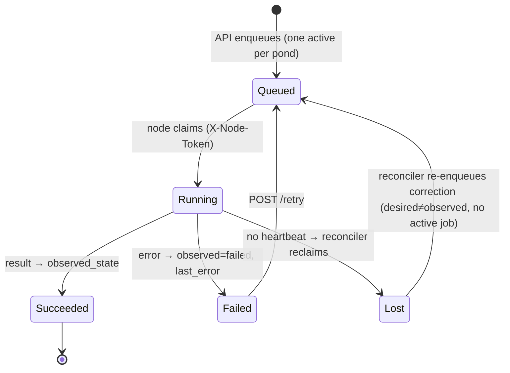

# L2 · 8 Provisioning workers (jobs, reconciler, node-agent)
Code: `apps/api/app/modules/jobs/service.py`, `workers/reconciler.py` (30 s loop), `apps/node-agent/agent/` (client, handlers, sampler, docker_driver).

| # | From | Event | Guard | To | Side effect | e2e test |
|---|---|---|---|---|---|---|
| W1 | Queued | claim | node token ok | Running | — | `workers: node claims queued job` |
| W2 | Running | success | — | Succeeded | observed updated | `lifecycle: create goes provisioning→en línea` |
| W3 | Running | failure | — | Failed | last_error | `lifecycle: provisioning failure shows Con fallas` |
| W4 | Running | stale | — | Lost | reclaimed | `workers: zombie job reclaimed` |
| W5 | — | drift | desired≠observed, no job | Queued | one correction job | `workers: reconciler fixes drift once` |
| W6 | — | drift | desired=deleted, pre_delete pending | — | skipped (pre_delete wins) | `workers: reconciler waits for pre_delete` |
| W7 | — | sample | — | — | `pond_samples` row | `metering: samples feed usage` |
