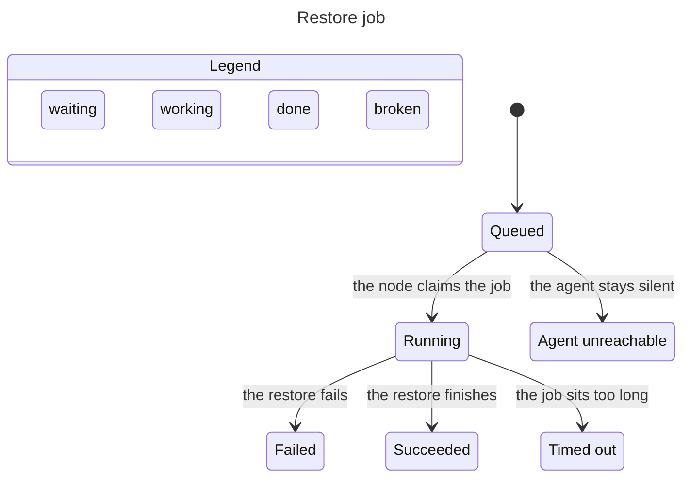

# L2 · Restore job

Code: `apps/api/app/modules/backups/service.py` (`restore`), `apps/api/app/modules/jobs/service.py` (`claim`, `complete`), `apps/api/app/workers/reconciler.py` (`_reclaim_zombies`), `apps/node-agent/agent/main.py` (`run_once`), `apps/node-agent/agent/handlers/restore_pond.py`, `apps/web/src/features/ponds/backups-page.tsx`.

Model: `docs/statechart/model/RestoreJob.tla`. `AsIs = FALSE` is the behavior this fix aims at. `AsIs = TRUE` is what main does today. The target chart hides `Advance`, `Done`, and `Stuck` (19 steps). Those steps only move the clock or stutter in an end state.



| # | From | Event | Guard | To | Side effect | Check |
|---|---|---|---|---|---|---|
| R1 | Queued | the node claims the job | agent up | Running | `jobs.status=running` | docker agent claims `restore_pond` |
| R2 | Running | the restore finishes | dump file present | Succeeded | pond `running`, `last_restore_at` set | same test, final status `succeeded` |
| R3 | Running | the restore fails | dump missing or `psql` error | Failed | `last_error` set, pond `failed` | failure-path test |
| R4 | Running | the job sits too long | claimed and not completed | Timed out | reconciler marks the zombie failed after retries | existing zombie reclaim |
| R5 | Queued | the agent stays silent | no claim before the clock runs out | Agent unreachable | job leaves `queued` with a reason | not in this change |
| R6 | Queued or Running on screen | the job read fails | HTTP 500 or 404 | Polling error | the screen leaves the non-terminal status and offers Reintentar | `job polling error doesn't leave the UI stuck in a non-terminal state` |

R6 is the screen transition. TLC does not draw it. The named test in `apps/web/src/features/ponds/__tests__/backups.test.tsx` is the check.

## Rules

- **ScreenShowsJob.** The backups screen shows the same status as the job.
- **AgentDownEnds.** A silent agent does not leave the restore queued.
- **PollErrorLeaves.** A failed job read does not leave the screen on `queued` or `running`.

On `AsIs = FALSE`, TLC reached 22 states and 34 steps. Both rules hold. The chart draws 6 states and 5 arrows.

## Paths that break today (`AsIs = TRUE`)

TLC reached the same 22 states. The chart hides 11 steps and does not draw 6 steps that stay in one chart state.

**ScreenShowsJob.** The screen shows the same status as the job.

1. Queued
2. the node claims the job: Running, screen still says queued

Replay: `BackupsPage` stores the job id and renders the literal `queued` (`apps/web/src/features/ponds/backups-page.tsx`). `JobService.claim` does move the row to `running`. The screen never reads it. The same freeze covers succeeded, failed, and timed out.

**AgentDownEnds.** A silent agent does not leave the restore queued.

1. Queued
2. time passes: Queued
3. time passes: Queued
4. time passes: Agent unreachable

Replay: `_reclaim_zombies` selects only `status == running`. A queued restore with no heartbeat stays `queued`. This change does not add that timeout. The screen bug is the one a person sees on demo-pond even after the agent finishes.

Ruled out by reading the claim path. `run_once` calls `claim_job()` with no `max_types`. `HANDLERS` includes `restore_pond`. There is a dispatcher, and the type string matches `JobType.RESTORE_POND`.

## Regenerate

```sh
TLA2TOOLS=/tmp/tla2tools.jar JAVA=/usr/bin/java \
  node --experimental-strip-types <statechart-skill>/scripts/statechart.ts \
  docs/statechart/model/RestoreJob.tla \
  --config docs/statechart/model/RestoreJobTarget.cfg \
  --view docs/statechart/model/restore-job.view.ts \
  --out /tmp/restore-job-target
```

Use `RestoreJobAsIs.cfg` and `restore-job-asis.view.ts` with a different `--out` for the break paths. The model leaves out concurrent ponds, a second node, and the reconciler's requeue of a running zombie back to queued before the attempt cap.
