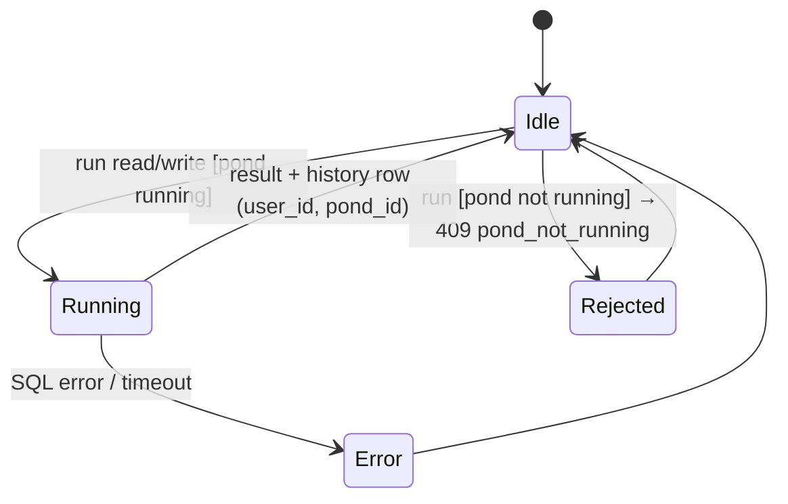

# L2 · 4 SQL console
Code: `apps/api/app/modules/sql_console/`, web `features/sql-console/`, `api/hooks/sql-console.ts`, `mocks/handlers.ts:207`.

| # | From | Event | Guard | To | Side effect | e2e test |
|---|---|---|---|---|---|---|
| S1 | Idle | run | running | Running→Idle | history row | `console: query runs and appears in history` |
| S2 | Idle | run | not running | Rejected | 409 | `console: stopped pond returns pond_not_running` |
| S3 | Running | SQL error | — | Error | message shown, history row | `console: sql error shows message` |
| S4 | Idle | open Consola | — | Idle | history only this pond | `console: new pond has empty history` |
| S5 | — | history of foreign pond | — | — | 403/404 | `console: foreign pond history rejected` |
