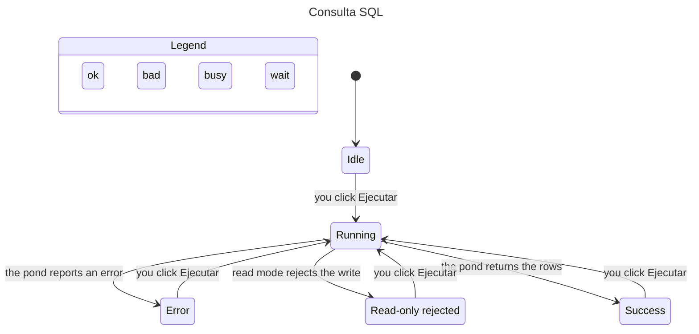

# L2 · SQL query run

What the reader sees after clicking Ejecutar. The pond row does not change when read mode rejects a write. A successful read leaves the query in history.

TLC on `sql-query/SqlQuery.cfg` reached 12 states. These rules hold: `ReadOnlyKeepsTheRow`, `SuccessRemembersTheQuery`, `RejectedDidNotWrite`, `NoDeadlock`.



Regenerate from the repo root, with `TLA2TOOLS` pointing at `tla2tools.jar` and `JAVA` at a Java 11+ binary:

```
docs/statechart/level2/sql-query is the spec
statechart SqlQuery.tla --config SqlQuery.cfg --view view.ts --out out
```

The chart hides no steps. It does not model `pond_not_running`. That code is not in the error catalog.
