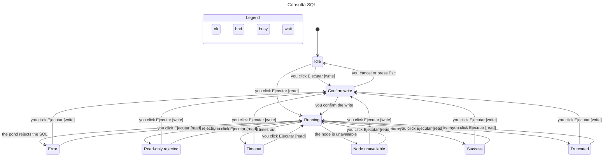

# L2 · SQL query run

What the reader sees after clicking Ejecutar. Read mode runs immediately. Write mode waits on a confirmation dialog. Esc and Cancel leave the query unsent. A rejected statement, a timeout, a stopped node, and a read-only write do not change the pond row and do not append history.

TLC on `sql-query/SqlQuery.cfg` reached 55 states. These rules hold: `ReadOnlyKeepsTheRow`, `SuccessRemembersTheQuery`, `RejectedDidNotWrite`, `ErrorDidNotWrite`, `NoDeadlock`.



## Transition table

One row per transition. A finished screen (Success, Truncated, Error, Timeout, Node unavailable, Read-only rejected) accepts Ejecutar again. Those retries use the same tests as the first run.

| # | From | Event | Guard | To | Side effect | Test |
|---|---|---|---|---|---|---|
| Q1 | Idle | you click Ejecutar | mode read | Running | POST `{mode:read}` | `one Ejecutar click returns the pond row and records history` |
| Q2 | Running | the pond returns the rows | under 1000 rows | Success | history row | `one Ejecutar click returns the pond row and records history` |
| Q3 | Running | the pond hits the row cap | 1001st row | Truncated | 1000 rows, `truncated=true`, history row | `test_sql_endpoint_caps_rows_at_1000` |
| Q4 | Running | the pond rejects the SQL | syntax, missing table, or privilege | Error | 400 `sql_error`, fixed Spanish message, no driver text, no history row | `test_user_sql_error_is_4xx` · `shows a safe message for a user SQL error` |
| Q5 | Running | the pond times out | statement longer than 10 s | Timeout | 504 `sql_timeout` | `test_sql_endpoint_timeout_returns_sql_timeout` |
| Q6 | Running | the node is unavailable | pond stopped or unreachable | Node unavailable | 503 `node_unavailable` | `test_sql_endpoint_stopped_pond_returns_node_unavailable` |
| Q7 | Running | read mode rejects the write | mode read and a write statement | Read-only rejected | 400 `sql_readonly_violation`, row unchanged | `test_sql_endpoint_read_mode_rejects_writes` |
| Q8 | Idle | you click Ejecutar | mode write | Confirm write | no POST, focus stays in the dialog | `does not run a write until you confirm, and cancel or escape aborts it` · `traps focus in the write confirmation` |
| Q9 | Confirm write | you cancel or press Esc | dialog open | Idle | no POST | `does not run a write until you confirm, and cancel or escape aborts it` |
| Q10 | Confirm write | you confirm the write | dialog open | Running | POST `{mode:write}` | `runs the write after confirmation` |
| Q11 | finished screen | you click Ejecutar | read or write | Running or Confirm write | same as Q1 or Q8 | `shows a safe message for a user SQL error` |

Regenerate from the repo root, with `TLA2TOOLS` pointing at `tla2tools.jar` and `JAVA` at a Java 11+ binary:

```
docs/statechart/level2/sql-query is the spec
statechart SqlQuery.tla --config SqlQuery.cfg --view view.ts --out out
```

The chart draws every step. It does not model `pond_not_running`. That code is not in the error catalog. A stopped pond is `node_unavailable`.
