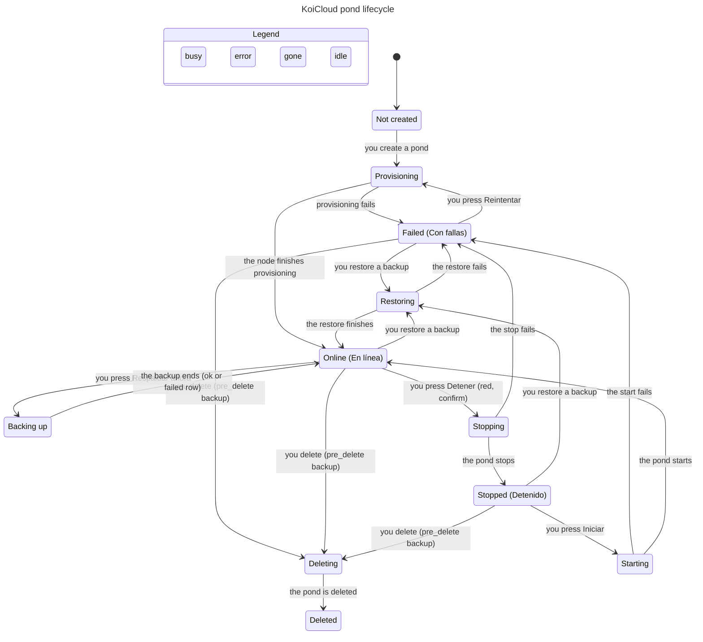
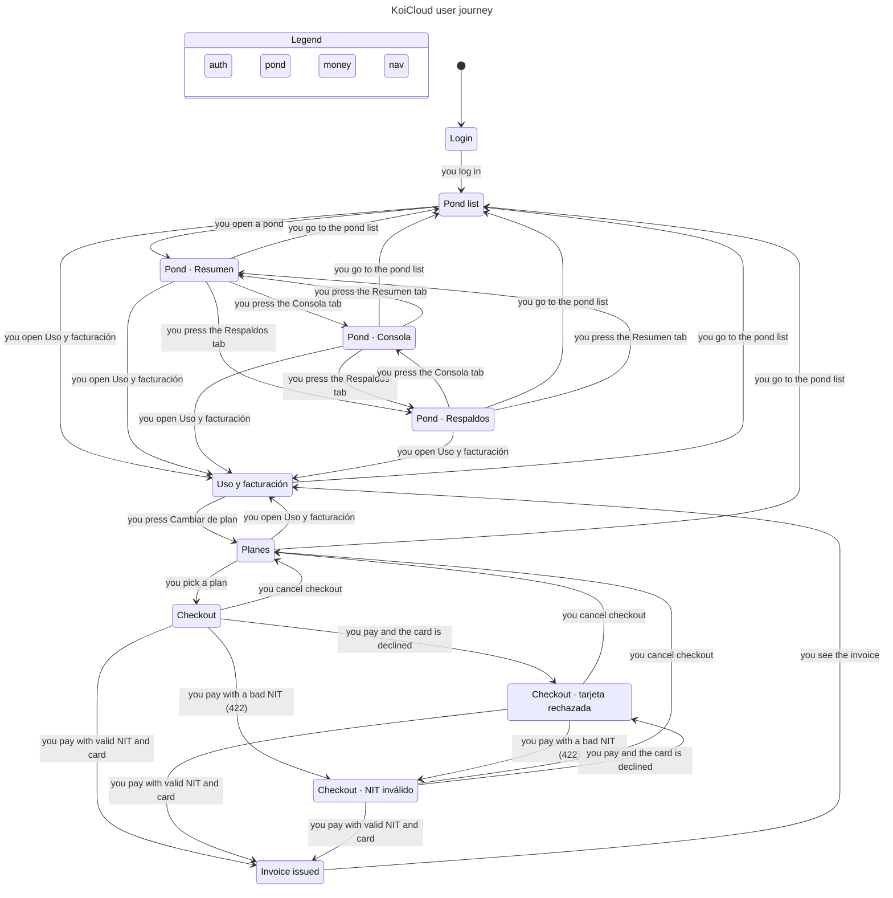
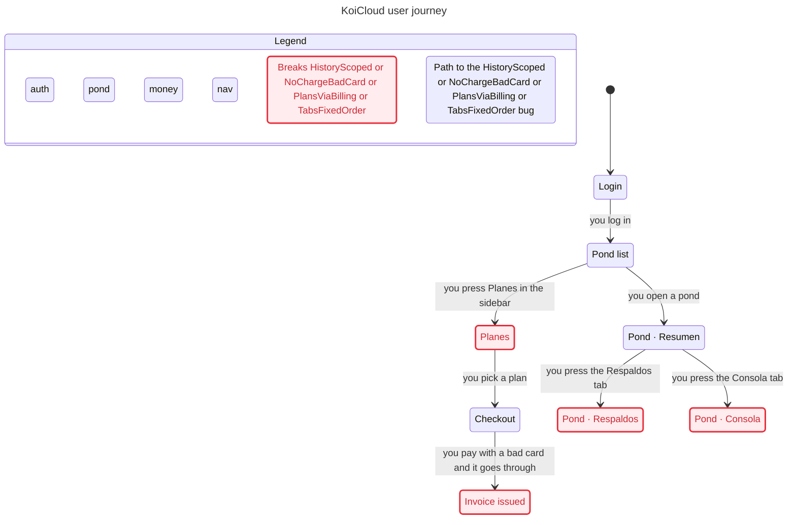

# Ponds: lifecycle and user journey statecharts

Source of truth: contract #96 (r2 statechart, r3 stop/start, r4, r5) and `main` @ `72015b5`.
Model: [`model/`](model/) (TLA+, checked with TLC). Re-run: `docs/statechart/model/check.sh`.
Charts below are generated from the model by the pstack `/statechart` skill (log-out, 409 no-op clicks and SQL runs are hidden: they don't change the chart state).

## (a) Pond lifecycle

States are what the UI shows (`apps/web/src/features/ponds/pond-state.ts`). `Stopping`/`Starting`/`Backing up` are the r3 transitional display (desired != observed with a job in flight). Every lifecycle request goes through `_assert_no_active_job` (`apps/api/app/modules/ponds/service.py`): a click while a job is in flight, or from the wrong state, gets **409 `pond_busy`** and nothing changes. SQL console on a non-running pond gets **409 `pond_not_running`** (r2 A4). After delete is accepted, `desired_state=deleted` and every call returns **404 `pond_not_found`**.

## (b) User journey (target, with #96 r6)

Nav per r6: **Uso y facturación** is one screen; **Planes** is not in the sidebar, it is reached from *Tu plan actual → Cambiar de plan*. Pond detail always shows tabs **Resumen · Respaldos · Consola** in that order. Reload keeps the session.

### As-is on `main` (bug paths only, model `Fixed = FALSE`)

| Rule broken on main | Shortest path | Code |
|---|---|---|
| PlansViaBilling | log in → *Planes* in sidebar | `app/layout/nav-config.ts:42-44` (Uso del mes, Facturación, Planes are 3 items) |
| TabsFixedOrder | log in → open pond → Respaldos tab | `backups-page.tsx:102-104` renders only Resumen·Respaldos; `sql-console-page.tsx:47-51` renders Resumen·Consola·Respaldos |
| HistoryScoped | log in → open brand-new pond → Consola | API is scoped (`sql_console/service.py:78-81` filters user_id + pond_id); **MSW mock** `mocks/handlers.ts:207` returns `fixtures.sqlHistory` for any `:pondId` |
| NoChargeBadCard | log in → Planes → pick plan → pay with an invalid card → invoice issued | `checkout-modal.tsx:22-33` sends only `{plan_id, nit}`; card fields are `required` text, never validated or sent; no decline path in the API |

## Transition table

One named e2e test per transition (Playwright, `e2e/pond-lifecycle/` and a new `e2e/journey/`). L = lifecycle, J = journey.

| # | From | Event | Guard | To | Side effect | e2e test |
|---|---|---|---|---|---|---|
| L1 | Not created | you submit Crear pond | plan allows, quota ok, name free | Provisioning | `POST /ponds` 202, create_pond job | `lifecycle: create goes provisioning→en línea` |
| L2 | Not created | you submit Crear pond | name taken / quota / no plan / no node | Not created | 409/422 `pond_name_taken`·`quota_exceeded`·`plan_required`·`node_unavailable`, form error | `lifecycle: create rejected shows error` |
| L3 | Provisioning | job succeeds | — | Online | observed=running | `lifecycle: create goes provisioning→en línea` |
| L4 | Provisioning | job fails | — | Failed | `last_error` set | `lifecycle: provisioning failure shows Con fallas` |
| L5 | Failed | you press Reintentar | no job in flight | Provisioning | `POST /retry`, job requeued | `lifecycle: retry after failure` |
| L6 | Online | you press Detener (red, confirm) | observed=running, no job | Stopping | `POST /stop` 202, desired=stopped | `lifecycle: stop then start` |
| L7 | Stopping | job succeeds | — | Stopped | observed=stopped | `lifecycle: stop then start` |
| L8 | Stopping | job fails | — | Failed | `last_error` | `lifecycle: stop failure shows Con fallas` |
| L9 | Stopped | you press Iniciar | observed=stopped, no job | Starting | `POST /start` 202, desired=running | `lifecycle: stop then start` |
| L10 | Starting | job succeeds | — | Online | observed=running | `lifecycle: stop then start` |
| L11 | Starting | job fails | — | Failed | `last_error` | `lifecycle: start failure shows Con fallas` |
| L12 | Online | you press Respaldar ahora | no job | Backing up | `POST /backups`, manual backup row | `lifecycle: backup now adds a row` |
| L13 | Backing up | job ends (ok or failed) | — | Online | backup row succeeded/failed | `lifecycle: failed backup keeps pond online` |
| L14 | Online / Stopped / Failed | you restore a backup | backup succeeded and of this pond, no job | Restoring | `POST /restore`, observed=restoring | `lifecycle: restore from backup` |
| L15 | Restoring | job succeeds | — | Online | — | `lifecycle: restore from backup` |
| L16 | Restoring | job fails | — | Failed | `last_error` | `lifecycle: restore failure shows Con fallas` |
| L17 | Online / Stopped / Failed | you delete (type the name) | no job | Deleting | desired=deleted, pre_delete backup job | `lifecycle: delete with pre_delete backup` |
| L18 | Deleting | delete job succeeds | — | Deleted | pond hidden, later calls 404 | `lifecycle: delete with pre_delete backup` |
| L19 | any busy state | you press any lifecycle action | job in flight / wrong state | same | 409 `pond_busy`, buttons disabled | `lifecycle: double click returns pond_busy` |
| L20 | Deleted | any action (start, restore, sql) | — | Deleted | 404 `pond_not_found` | `lifecycle: deleted pond rejects start` |
| L21 | Online | you run SQL (read/write) | — | Online | row appended to this pond's history | `console: query runs and appears in history` |
| L22 | not Online | you run SQL | — | same | 409 `pond_not_running`, UI message | `console: stopped pond returns pond_not_running` |
| J1 | Login | you log in | valid credentials | Pond list | tokens issued | `journey: login lands on pond list` |
| J2 | Login | you log in | bad credentials / unverified | Login | 401, error shown | `journey: bad login stays on login` |
| J3 | any (logged in) | you reload | — | same screen | session restored (refresh token) | `journey: reload keeps session` |
| J4 | any (logged in) | you log out | — | Login | tokens revoked | `journey: logout returns to login` |
| J5 | Pond list | you open a pond | — | Pond · Resumen | tabs Resumen·Respaldos·Consola | `journey: pond tabs fixed order (resumen)` |
| J6 | Pond tab | you press Respaldos | — | Pond · Respaldos | same 3 tabs, same order | `journey: pond tabs fixed order (respaldos)` |
| J7 | Pond tab | you press Consola | — | Pond · Consola | same 3 tabs; history only for this pond | `journey: pond tabs fixed order (consola)` + `console: new pond has empty history` |
| J8 | Pond tab | you press Resumen | — | Pond · Resumen | — | `journey: pond tabs fixed order (resumen)` |
| J9 | any | you open Uso y facturación | — | Uso y facturación | usage + invoices on one screen | `journey: uso y facturacion is one screen` |
| J10 | Uso y facturación | you press Cambiar de plan | — | Planes | — | `journey: planes only via cambiar de plan` |
| J11 | Planes | you pick a plan | — | Checkout | modal opens | `checkout: valid nit and card issues invoice` |
| J12 | Checkout / error | you pay | NIT ok, card ok | Invoice issued | `POST /subscriptions {plan_id,nit}`, `InvoiceOut` lines/total | `checkout: valid nit and card issues invoice` |
| J13 | Checkout / error | you pay | NIT > 32 chars | Checkout · NIT inválido | 422, field error, nothing charged | `checkout: invalid nit shows error` |
| J14 | Checkout / error | you pay | card invalid / declined | Checkout · tarjeta rechazada | no subscription, no invoice | `checkout: declined card shows error` |
| J15 | Checkout · error | you fix and pay again (retry) | NIT ok, card ok | Invoice issued | one subscription only | `checkout: retry after decline succeeds` |
| J16 | Checkout / error | you cancel | — | Planes | nothing created | `checkout: cancel creates nothing` |
| J17 | Invoice issued | you see the invoice | — | Uso y facturación | invoice in history with NIT | `checkout: valid nit and card issues invoice` |

## Invariants

| Rule (TLA+ name) | Plain sentence | Harm if broken | Model | Status on main |
|---|---|---|---|---|
| TabsFixedOrder | Every pond page shows Resumen, Respaldos, Consola, in that order, in every pond state. | Users lose their place; Respaldos page has no way to Consola. | UserJourney | **breaks** |
| HistoryScoped | The console shows only queries run on the pond you are looking at. | Leaks other ponds' SQL; a new pond looks used. | UserJourney | **breaks** (MSW preview); API holds |
| ReloadKeepsSession | A failed refresh leaves you on the login screen. A successful reload keeps the session. | A rejected refresh still shows the app. | UserJourney | holds |
| PlansViaBilling | Planes is reached only from Uso y facturación (Cambiar de plan). | r6 nav not done. | UserJourney | **breaks** (not implemented) |
| NoChargeBadCard | An invoice is issued only when the card was validated. | A plan change goes through with garbage card data. | UserJourney | **breaks** (no card check) |
| OneInFlightOp | A pond has at most one lifecycle job in flight, and is in a transitional state exactly when it has one. | Racing stop/start/delete corrupts data. | PondLifecycle | holds |
| NoStartOnDeleted | Once deleted, a pond never leaves Deleted (no start, restore, SQL). | Ghost ponds, billing on deleted data. | PondLifecycle | holds |
| ConsoleOnlyWhenRunning | SQL runs only on an Online pond; otherwise 409 `pond_not_running`. | Errors / hangs on stopped containers. | PondLifecycle | holds |

Not modelled: multiple users/ponds racing on one node, the daily backup scheduler, the reconciler, token expiry/refresh races, admin suspend, the delete step after a failed pre_delete backup, Detener's red styling (UI-only, see r6).
