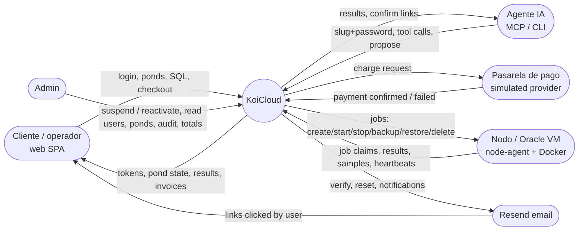
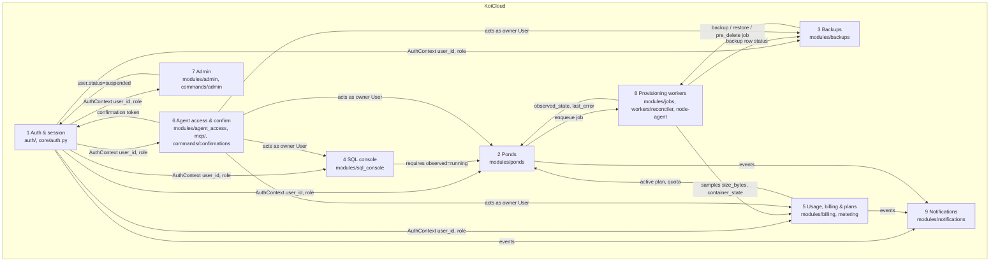

# KoiCloud system map (DFD-style levels)

Grounded in contract #96 (r2–r5) and `origin/main` @ `72015b5`. Level 2 files are in [`level2/`](level2/); the pond lifecycle and user journey are in [`ponds.md`](ponds.md). TLA+ models: [`model/`](model/) (re-run with `model/check.sh`).

## Level 0: context

## Level 1: subsystems

### Flows between subsystems

| Flow | From → To | Data / event | Code |
|---|---|---|---|
| F1 | Auth → all | bearer JWT (15 min) → `AuthContext` | `core/auth.py:get_current_user` |
| F2 | Billing → Ponds | active subscription / plan quota on create | `ponds/service.py` (`plan_required`, `quota_exceeded`) |
| F3 | Ponds/Backups → Workers | `jobs` row queued (one active per pond) | `_assert_no_active_job`, `jobs/service.py` |
| F4 | Workers → Ponds/Backups | job result → `pond_status.observed_state`, backup status | `jobs/service.py`, node-agent handlers |
| F5 | Workers → Billing | `pond_samples` → daily `instance_hours`, `storage_gb_hours` | `metering/service.py` |
| F6 | Agent → everything | slug+password → owner `User` (full owner scope) | `agent_access/service.py:authenticate` |
| F7 | Admin → Auth | `users.status = suspended` | `commands/admin.py:suspend_user` |
| F8 | * → Notifications | verify/reset/pond/billing emails via Resend | `notifications/` |
| F9 | Payment → Billing | `confirm_payment` → subscription active, invoice paid | `billing/service.py`, `payments/simulated.py` |

## Cross-subsystem invariants (model `System.tla`)

| Rule | Plain sentence | main @ 72015b5 |
|---|---|---|
| NoPondApiWhenLoggedOut | After you log out, no pond call with your old access token works. | holds: logout stores the access `jti` and `get_current_user` rejects it with 401 `token_invalid` |
| NoPondApiWhenSuspended | A suspended user cannot reach any pond API. | **breaks**: `get_current_user` hard-codes `status=ACTIVE`; suspend revokes nothing |
| AgentScopeWithinOwner | The agent can never do what its owner can't. | **breaks**: `agent_access.authenticate` does not check `user.status` |
| DeletedPondHasNoJobs | A deleted pond has no job in flight. | holds |
| DeletedPondAccruesNoUsage | A deleted pond adds no billed hours. | **breaks**: `compute_day_metrics` counts the tail after the last sample as running when that sample was running |

Shortest paths (from `/statechart` on `SystemAsIs.cfg`):
- NoPondApiWhenLoggedOut holds. The path that used to break was log in → log out (access still live) → the pond API answers. Logout now clears the access token, so that call is refused.
- NoPondApiWhenSuspended: log in → admin suspends you → the pond API still answers.
- AgentScopeWithinOwner: log in → suspended → agent on → agent creates a pond.
- DeletedPondAccruesNoUsage: create → online → node sample (running) → delete → deleted → daily metering bills the rest of the day.

Fixed model (`SystemFixed.cfg`): 88 states, all rules hold. Not modelled: multiple users/nodes, refresh-token rotation races, payment webhooks, email delivery failures.
